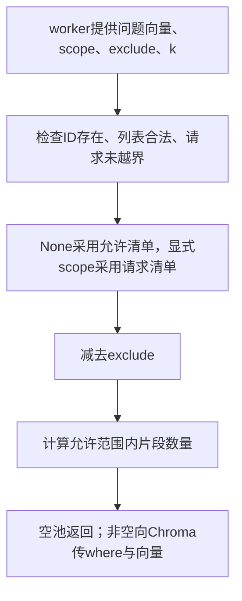

# Lesson 1：检索前确定文档范围

日期：2026-10-10。目标：理解ChromaStore.query如何在数据库查询前计算有效文档范围。

## 数据流

## 代码地图

| 文件/函数 | 职责 |
|---|---|
| [worker.execute](../../../experiments/chroma_worker.py) | 当前实验调用方，从缓存取向量和任务范围 |
| [ChromaStore.query](../../../naiyue_rag/chroma_store.py) | 校验范围、生成where、调用数据库；本课读到query第202行 |
| [validate_scope](../../../experiments/vector_index.py) | 文档存在性、列表类型/重复/空scope、排除项校验 |
| Chroma SDK Collection.query→客户端_query→Rust bindings.query | where实际下传；本课未讲ANN内部过滤算法 |

## 输入与关键结论

- vector为已经生成好的问题向量；本课不生成新向量。
- authorized_document_ids由应用配置，scope_ids是本次请求，exclude_ids是本次排除。
- 显式scope必须属于配置允许清单，越界明确报invalid_scope，不悄悄删掉越界项后继续。
- scope_ids=None表示采用允许清单；scope_ids=[]为当前契约中的无效请求。
- 条件表达式展开：先按None/显式scope取集合，再减exclude；allowed为局部变量，不改配置或删除记录。
- candidate_k限制片段返回数量，不扩大文档范围；n_results=min(candidate_k,count)。
- compared_count在此实现表示允许池的片段数量，不代表ANN实际访问节点。
- 正常排除至空池返回candidates=[]/compared_count=0，不调用Chroma.query；非法scope报错，二者不同。
- 在数据库查询时传where，避免先全库top-k再过滤导致允许文档被截掉；数据相关性和权限范围是不同概念。
- 当前允许清单是库接口约束，不代表已建成账号认证或生产复杂权限系统。

## 教学例子

A/B/C是假设文档代号，不是实测资料。允许A、B，请求A、B，排除B，则allowed={A}。如果全库前3名来自B/C，先取3条再过滤可能没有A；本实现将document_id in allowed随查询传入。此例不声称近似索引实现了严格全库排序。

## 理解检查及证据边界

题目：authorized_document_ids=[A,B]，scope_ids=None，exclude_ids=[A]，最终allowed是什么？

用户原回答：**“B”**。与代码计算的{"B"}一致，记录为本题引导后回答正确。尚无用户对越界拒绝、空scope、空池、SDK下传及过滤前后差别的独立复述；没有独立复写/调试/实现或面试追问考核。

本课范围契约测试上一轮实际7 passed,24 deselected in0.19s，使用SDK测试替身，仅验证参数与拒绝路径；原生实验与全量493为实施阶段证据，不冒称本课新运行。本轮只读源码与更新学习文档。

## 下一步

读取query的单条结果如何进入_bound_unit，区分数据库返回内容、原文快照与业务语义正确性。每轮一个理解问题，确认后再记录后续笔记。
