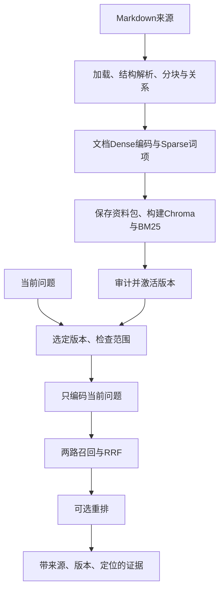

# Lesson 10：阶段B·1.2 建库与查询两条数据流

日期：2026-10-19。目标：沿同一份Markdown和一个问题，区分提前准备的检索产物与查询时的计算。示例来自`examples/core-demo/knowledge/`的合成计费材料，没有使用真实知识库或调用模型。

## 两条数据流

“离线建库”表示与具体问题分离、提前准备，不表示断网。当前配置的Embedding在建库与正常查询时都可调用远程API；本地CrossEncoder重排不意味着Embedding也已本地部署。当前核心建库不调用聊天模型阅读或总结Markdown，主要是结构规则、编码与索引。

## 具体数据及其变化

输入`L2_previous.md`包含：`折扣开关 discount_enabled=0 时不使用折扣。开关为 1 时使用系数 0.5。基础金额不变。`

结构准备产生文档身份、标题、原文位置、片段及上下文。说明中的“片段C”“向量[v1,v2,...]”仅为教学符号，不代表实际ID、切分数量或模型输出。片段分别形成Dense向量与Sparse词项/词频，通过片段身份配对；保存资料包与两种索引，最后激活可供查询使用的版本。

查询`移除折扣开关后，需要参考哪些历史需求和用例？`时，选择已激活版本并约束范围，编码问题，检索现有索引中的候选。RRF融合排名；可选后端只重排已召回候选，不能自行补回没召回的片段。证据组装按已保存原文和SourceSpan给出内容及定位，不生成最终测试用例。

## 实际代码地图

| 入口 | 输入与职责 | 输出/副作用 |
|---|---|---|
| IngestionPipeline.run | 当前目录文档、已保存版本、配置，先计划是否复用 | unchanged或进入完整构建 |
| IngestionPipeline._build_and_activate | 文档→prepare_knowledge_base→BatchProcessor→prepare_index_bundle | 保存资料包、构建两索引，再激活 |
| QueryPipeline.prepare | 问题、范围、revision | 固定版本与查询编码；空态跳过编码 |
| HybridSearch.search | 同一个PreparedQuery供两路消费 | Dense/Sparse候选与RRF结果 |
| CoreReranker.rerank | 已有候选、问题、配置 | 重排、关闭或空态结果 |
| RetrievalPipeline.query | 检索→重排→ResponseBuilder | 最终结构化证据 |

## 模型与计算边界

- Markdown加载、结构分块、显式关系：本地规则处理，不需要聊天模型。
- 文档和查询Dense编码：Embedding模型；不是生成回答，也不是训练知识库。
- Sparse分词/BM25、RRF、保存索引与证据组装：本地计算/存储，不调用生成模型。
- LLM重排：调用生成模型评分现有候选；本地CrossEncoder重排：本机模型推理；关闭或候选为空不调用重排后端。
- 两路共用一次查询编码，正常查询不会重新编码全库；HTTP次数、分批与用量以后按实际报告展开。

## 主要分支及易错点

| 情况 | 当前项目行为 |
|---|---|
| 首次摄取/内容或相关配置发生变化 | 构建候选版本；当前变化路径对合并保留集全量准备与编码，并非只编码变化片段 |
| 重复摄取且满足复用条件 | 核验并复用，不重新编码或构建索引 |
| 没有激活版本或有效范围为空 | 明确空态；跳过查询Embedding和空候选重排 |
| 两路召回某一路失败 | 整次明确报错，不伪装为空结果或隐式单路 |
| 新版本构建尚未激活 | 查询仍使用已选活动版本；激活提交结果不确定需读回核对，留到第4章 |
| 修改原Markdown但未再次摄取 | 当前查询仍读已保存版本，不自动看到文件最新改动 |

索引负责帮助查找；资料包负责保留来源、正文、片段与关联数据。保存文件不等于已经让查询使用它，激活是二者之间的显式连接。建库质量是检索质量的前提，重排只能处理已有候选，生成也不能可靠补造缺失证据。

## 测试学习入口（已读源码，本次未运行）

- `tests/test_ingestion_pipeline.py::test_first_ingestion_and_repeat_skip_encoding_and_builds`：首次建立版本，第二次复用；以forbidden替换编码/保存/构建，证明重复路径不能调用它们。
- `tests/test_evidence_response.py::test_pipeline_is_real_consumer_and_encodes_once`：查询实际编排与证据组装，外部编码/评分/原生查询边界用确定性替身；断言两种编码与评分各一次。
- 之后调试课从上述Test Explorer的Debug Test进入，优先断在`IngestionPipeline.run`或`RetrievalPipeline.query`；本节未要求用户执行或观察完整对象树。

## 理解证据与下一步

本节讲解上述数据流及计算边界，用户理解待反馈；本人调试、复写与独立实现未评估。“继续”不作为上一节已掌握的证据。

下一节1.3：展开真实查询输入和最终证据输出，理解文档ID、片段ID、来源、版本和原文定位各自解决什么问题。
