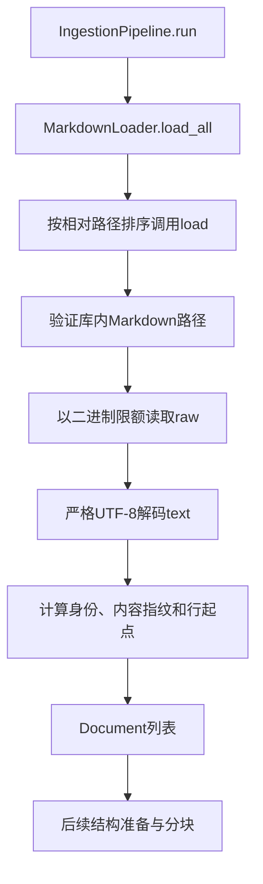

# Lesson 13：阶段B·2.1 Markdown读取与Document

日期：2026-10-20。第2章共6节，本节只讲加载，不提前进入标题/表格结构解析或切分算法。目标：沿一次真实加载理解bytes→str→Document，稳定身份、原文版本、限额和失败合同。

## 职责与输入输出

MarkdownLoader读取库内Markdown，保留原文并产生Document(id,text,metadata)。这里的结构化指文档记录有固定字段；不是已经构建标题树、表格或语法树。后续prepare_knowledge_base/DocumentChunker消费文档，在2.2及后续章节展开。

实际调用：`MarkdownLoader(Path('examples/core-demo/knowledge'),'core-demo',4096).load('L2_previous.md')`。4096是课堂明确传入的读取上限，不修改运行配置。根目录由调用方提供，相对路径指向单个文件。无模型/网络、索引写入或文件修改。

本次真实合成文件结果：Document.id=doc-83792e5839d7ab8009636522f11b55dfc298686eeb1840076f12763c672c4b4c；metadata.source_sha256=d3531e4b9156504f730363809e4b9632c4a781d7f6f6ae374aba83e3f2ae25e9；size_bytes=181；len(text)=97；line_starts=[0,12,13,32,33,41,42]。原文包含标题、链接、空行和折扣规则，全部原样保留。`doc.text.encode('utf-8') == 原文件字节`实测True。以上是本次本地加载结果，不是模型输出。

## 调用地图



单文件入口load返回Document；目录入口load_all返回list[Document]。loader构造只验证和保存根目录/知识库ID/限额，不在构造时读取所有文档。

## 关键函数与机制

### 1. 校验相对路径

`ingestion/markdown_loader.py::load`第50–62行校验路径：拒绝绝对路径、..和符号链接路径组件；resolve后仍必须属于根目录；单文件加载只接受.md（大小写不敏感），文件必须存在。根目录限定本次导入来源，不是用户/角色授权系统。本节不声称进行过文件系统并发攻击验证。

### 2. 为什么先读bytes

第63–73行读取`raw=handle.read(max_file_bytes+1)`，超限则LoadError(source_too_large)；未超限再`raw.decode('utf-8')`。例如上限4，读到5字节足以知道超限，不必把任意大文件读完；恰好4字节允许。

原始bytes代表磁盘上的编码结果；str代表解码后可按字符定位的文本。中文等字符的UTF-8字节数可能大于字符数，不能用len(text)作为文件字节限额。二进制读取也避免文本读取模式自动规范化换行；正文、BOM和LF/CRLF/CR保持，不用replace/ignore掩盖非法编码。原文与source_sha256来自同一份raw，不分别重读内容和hash，避免二者来自不同读取结果。

### 3. 两个不同目的的hash

文档身份：SHA256(UTF-8(JSON([knowledge_base_id,规范相对路径])))，前缀doc-。内容版本：SHA256(raw)。SHA256是确定性的内容摘要，不负责判断语义是否相同。

同库同路径修改正文：文档ID不变、内容指纹变化；同字节不同路径：文档ID不同、内容指纹相同；换绝对根目录但保留库ID和相对路径：文档ID相同。改名/移动路径不自动识别为同一文档，当前也不按内容hash把两个来源合并。

### 4. 行起点索引

第77–79行产生line_starts，位置按Python字符而非UTF-8字节。A\nB\n的字符下标是0=A、1=换行、2=B、3=换行，因此行起点[0,2]，末尾换行不添加一个虚构正文行；空文件为[]。

生成器表达式的等价普通写法：

```python
line_starts = [0] if text else []
for match in re.finditer(r'\r\n|\r|\n', text):
    next_start = match.end()
    if next_start < len(text):
        line_starts.append(next_start)
```

regex先匹配CRLF，再匹配单CR或LF，防止把一个CRLF拆成两次换行。行号和span转换在2.2继续展开。

### 5. 返回对象与扫描

第80–83行构造Document，核心类型在core/types.py::Document；__post_init__校验基本字段，to_dict产生可序列化且metadata防御复制的字典。Loader填写来源合同，Document不自动理解业务含义或调用LLM。

load_all扫描Markdown、对相对路径排序、逐份load；普通非Markdown文件在扫描时忽略，直接load非Markdown则报unsupported_source。目录为空返回[]，空Markdown返回合法text=''文档；任一文件失败则整次抛异常，不返回前面成功读取的部分列表。

## 分支与现有测试

| 分支 | 结果 | 测试入口（tests/test_markdown_loader.py） |
|---|---|---|
| 原字节/UTF-8/换行位置 | 返回原样Document | test_raw_bytes_text_hash_and_actual_line_starts[A-starts1]可从最小A开始；另有LF/CRLF/混合/BOM参数 |
| 同路径修订 | ID保持、source_sha变化 | test_update_retains_id_and_changes_version，无参数 |
| 空文件/空目录 | 合法空文档/[] | test_raw_bytes_text_hash_and_actual_line_starts[-starts0]；test_empty_directory_has_no_fabricated_document |
| 非UTF-8 | LoadError(invalid_source_encoding) | test_file_boundary_failures[encoding-invalid_source_encoding] |
| 过大 | LoadError(source_too_large) | test_file_boundary_failures[size-source_too_large] |
| 读文件失败 | LoadError(source_read_failed)，安全错误日志 | test_read_failure_safe_and_observable |
| 扫描失败/中途文件失败 | 整次失败，不当空成功/部分成功 | test_scan_failure_is_not_an_empty_success；test_batch_failure_raises_instead_of_returning_partial_list |

_fail在markdown_loader.py第15–17行只记录固定stage/code并抛LoadError；不把原始路径、正文或底层异常文本直接拼到异常中。不重试、不猜编码，调用方决定后续动作。

## Debug Test路线

### 正常读取及身份变化

Test Explorer：test_update_retains_id_and_changes_version（无参数）。入口tests/test_markdown_loader.py第49行，测试此前在tmp_path生成合成文件；生产load没有被替换。

- F11进入load；F5到markdown_loader.py第69行，选load栈帧：WATCH len(raw)、self._max_file_bytes。正常默认输入为b'# Heading\nBody\n'。
- F10执行UTF-8解码后，再看repr(text)，不重读文件获取内容。
- F5到第80行，观察relative、line_starts，返回测试后看before.id、before.metadata['source_sha256']。
- 测试第51行确实修改临时文件，第52行重新load；到第53行比较before.id==after.id及两个source_sha是否不同。副作用只在测试临时目录。

### 非UTF-8

Test Explorer参数ID encoding-invalid_source_encoding。测试第120行写b'\xff'，第123行调用load并期待LoadError。F5到生产第71行：raw.decode触发UnicodeDecodeError，第72–73行捕获并调用_fail；再到_fail第17行抛安全LoadError。测试捕获预期异常后仍通过。此例没有monkeypatch读取实现。

读权限故障另一个test_read_failure_safe_and_observable在第183行替换Path.open，实际注入在第182行raise PermissionError，生产第67–68行捕获，最后日志只保留stage/code；不把这个替身测试解释为真实权限故障。

## 本次验证

命令：`.venv/bin/python -m pytest -q tests/test_markdown_loader.py`。

实际输出：`43 passed in 0.14s`。模块测试自动拦截socket.connect/connect_ex；无模型请求。独立合成文件加载验证181字节/97字符及编码回写相等；无真实文档、.env或配置修改。git diff --check另作文档检查。

## 理解证据与下一步

2.1讲解与助手本地加载/测试已进行；用户理解待反馈，用户本人Debug Test、复写或独立实现尚未评估。

下一节2.2：标题、正文、代码块和表格如何由Markdown语法结构映射到真实原文位置，沿同一来源继续追踪，不跳到切分参数优化。
