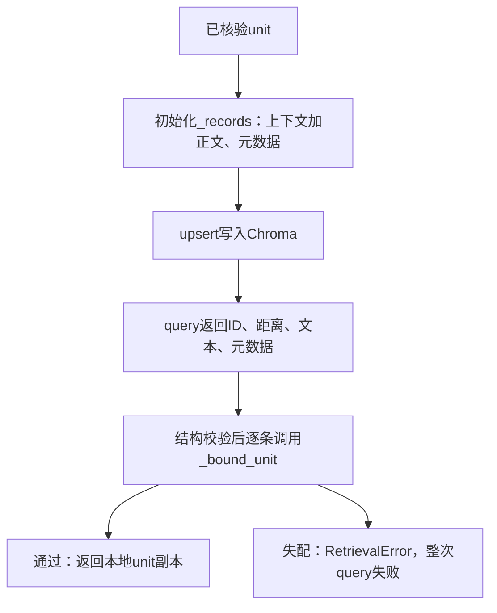

# Lesson 2：把数据库候选绑定到已核验原文

日期：2026-10-10。目标：理解返回候选如何核对ID、范围、文本与元数据，以及失配怎样导致整次查询失败。

## 数据流

## 代码地图

| 函数 | 已讲解内容 |
|---|---|
| [ChromaStore.__init__](../../../naiyue_rag/chroma_store.py) | canonical unit→_records，元数据保存完整canonical_json |
| [make_index_text](../../../experiments/vector_index.py) | contexts文本和body按换行拼接，database document不同于仅body |
| ChromaStore.upsert | 写入同一ID对应的向量、预期文本和元数据 |
| ChromaStore.query→_bound_unit | 检查已知ID、文档属于allowed、文本和元数据与预期完全一致 |
| fail→query异常分支→[worker.main](../../../experiments/chroma_worker.py) | 记录安全错误并抛异常；调用方status=error/退出2 |

## 关键理解

- self.units保存已核验原文片段；self._records[uid]保存预期写入的(text,metadata)。
- metadata包含document_id/source_sha256/role/kind以及完整unit的JSON字符串。此处比较整个元数据，不临时重新解析后忽略差异。
- 数据库返回文本应与make_index_text输出一致，不能只与unit.body比较。
- _bound_unit用本地unit的document_id核allowed，不能只相信返回metadata声称的文档。
- ID未知、越界、正文/元数据失配都invalid_chroma_result；不会用本地正确内容悄悄替换故障结果。
- 正常通过时返回deepcopy(self.units[uid])，调用方修改返回值不影响内部片段；之后query添加检索字段。
- 当前策略一条异常即整次失败；先前累积的其他候选不作为部分成功返回。query的except RetrievalError: raise继续传播同一异常。
- 内容与来源绑定一致不证明历史业务规则仍然有效；语义适用性需要Agent阅读新旧证据判断。
- 本课只概述SDK数组结构与逐条传值，尚未完整讲解嵌套数组、zip strict和所有超限路径；距离/分数/排序另课。

## 理解检查

1. 正文与预期不同，即使ID/版本正确且本地有正确原文，如何处理？用户原回答“丢弃”。登记为认为异常证据不应使用；该词尚不能单独说明整次失败。
2. 补充实际异常传播后，提问5条结果中4条正常、1条失配，应返回4条还是整次报错？用户原回答 **“整次报错”**，与当前代码一致。

记录为引导后回答正确；完整校验条件、复制语义及异常传播的独立复述/实现仍未验证，不登记面试能力。

## 验证边界

讲解阶段曾实际运行9项SDK替身异常契约：9 passed,22 deselected in0.07s；不是9次原生检索。随后异常传播补课只读源码、未重跑测试。本轮确认回答并写笔记，没有改实现、运行新服务/模型。实施阶段全量493与原生缓存实验是既有记录，不冒称本课新全量结果。

## 下一步

读取query第214–219行的距离校验、cosine与参考分数转换，以及排序；暂不展开RRF算法或增加新功能。
