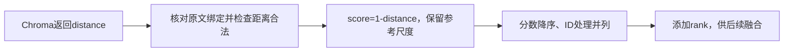

# Lesson 3：余弦距离、分数尺度与排序

讲解日期：2026-10-10；理解题回答日期：2026-10-11。目标：理解Chroma cosine距离如何转换为候选分数及排名。

## 数据流与代码地图

实际代码：[ChromaStore.query](../../../naiyue_rag/chroma_store.py)第214–219行。当前集合配置space=cosine；参考源码使用1-distance/2展示分数，保留为reference_similarity。融合在[rank_fusion.fuse](../../../experiments/rank_fusion.py)中消费rank，算法另课。

## 关键理解

- 当前使用余弦距离，distance=1-cosine_similarity，因此score=1-distance。
- 距离越小，原始余弦分数越大；理想数学范围distance为[0,2]，cosine为[-1,1]。
- reference_similarity=max(0,1-distance/2)保留参考项目的线性展示尺度，理想范围[0,1]；不能把它称为原始余弦值。
- score_kind='cosine'说明score含义；dict(unit,...)保留原文片段字段并添加检索信息。
- score=0.8不代表80%相关概率，也不证明旧规则适用新需求。
- sort key=(-score,unit_id)使分数大者在前、并列时按ID确定顺序；随后从1编号rank。
- 距离类型、有限性与范围校验失败会整次报错，边界采用已定1e-6浮点容差，不将异常距离填成0。

## 真实记录与教学示例

讲解时只读既有正式run的首条记录：distance=0.3634178042411804，score=0.6365821957588196，reference_similarity=0.8182910978794098。不是新查询或模型请求。其他A/B候选0.2/0.7等数字为明确标记的教学示意，不登记为业务实验。

## 理解检查

题目：distance=1.0，score与reference_similarity分别是多少？

用户原回答：**“0，0.5”**。与1−1=0、max(0,1−1/2)=0.5一致，记录为本题引导后计算正确。余弦公式推导、负号排序、并列处理的独立复述/复写及业务质量判断未验证，不登记独立实现或面试能力。

## 下一步

只讲等权RRF如何根据两路排名累计贡献，先用现有测试a/b/c样本，再追实际fuse的累加状态；不展开重排或新增算法。
