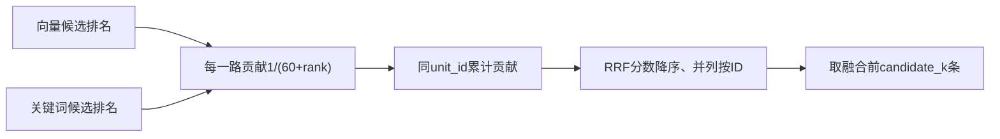

# Lesson 4：按两路排名做等权RRF融合

日期：2026-10-11。目标：理解排名贡献如何按片段ID累加，并与原始检索分数、候选数量区分。

## 数据流与代码地图

调用方：[chroma_probe.compare](../../../experiments/chroma_probe.py)；核心：[rank_fusion.fuse](../../../experiments/rank_fusion.py)；对照测试：[test_equal_weight_rank_contributions_and_single_route](../../../tests/test_rank_fusion.py)。

## 具体状态

使用既有合成测试输入dense=[b,a]、sparse=[a,c]，其中a/b/c为片段ID，不是文档级合并。

| 片段 | 向量贡献 | 关键词贡献 | 总分 |
|---|---|---|---|
| a | 第2名1/62 | 第1名1/61 | .03252247 |
| b | 第1名1/61 | 无0 | .01639344 |
| c | 无0 | 第2名1/62 | .01612903 |

实际调用fuse输出顺序a/b/c，与手算一致；此为算法测试输入，不代表业务相关性或新原生数据库实验。

## 关键理解

- 当前固定rrf_k=60控制排名贡献的衰减；candidate_k控制融合结果截取数量，二者不同。
- 原cosine与BM25尺度不同，当前等权RRF用排名计算贡献，不直接相加原分数。
- accumulated按unit_id保存新融合记录，第一次出现分数0；后续各路出现时累计贡献。
- 同片段跨路累加，原文仍一份；每路内部重复ID会校验失败，不重复计分。
- 原cosine/BM25与各路rank/contribution保留在retrieval_info便于解释，不作为相关概率。
- 某一路成功但候选为空，贡献为0；一路调用失败仍应显式报错，不能擅自伪装为空路。
- 排序后union_candidates为并集排序，candidates是前k截取；之后证据预算还可能排除候选。
- 融合不能从两路都未召回的材料中凭空补出证据，分数更高不证明业务规则正确。

## 理解检查

题目：某片段向量相似度0.8变0.9，但两路候选排名不变，RRF分数会变化吗？

用户原回答：**“不会”**。与当前贡献公式一致，登记该引导题回答正确。原分数记录retrieval_info.cosine会变化，因此不是整个返回对象字节不变。公式复写、异常校验、参数衰减取舍的独立实现/追问未验证。

## 验证边界与下一步

上一讲实际用测试输入调用fuse并运行已有测试，1 passed in0.00s；本轮确认回答，不重复冒称全量493或新数据库服务结果。业务代码/环境未改。

下一课只读pack_evidence：为什么融合候选已命中，仍可能因完整证据和字符预算未返回；区分召回、融合截取、预算损失。
