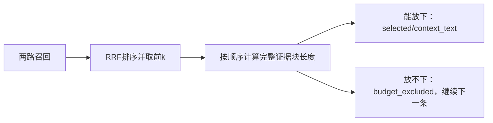

# Lesson 5：完整证据的字符预算

日期：2026-10-11。目标：区分融合候选与最终证据，理解超预算时记录并继续的控制流。

## 数据流与代码地图

调用方：[chroma_probe.compare](../../../experiments/chroma_probe.py)；核心：[pack_evidence](../../../experiments/vector_index.py)第211–244行；原文渲染：[render_unit](../../../experiments/evidence_units.py)；已有测试：[完整长用例排除后继续](../../../tests/test_vector_index.py)。

## 输入、状态与输出

- 输入为融合排序的candidates及max_context_chars；candidate_k限制候选数量，字符预算限制context_text大小。
- block=prefix+rendered_text；rendered_text包含ID/来源/版本/位置/上下文/正文，预算不只算body。
- 当前检索前缀固定36字符；第一块没有额外分隔符，后续块加2字符的双换行。
- selected保存选中候选，skipped保存预算排除候选，blocks保存完整证据文本，chars记录当前长度；seen避免同ID重复输出。
- 超预算时记录reason=budget_excluded并continue；放得下才追加block、增加chars、追加selected。
- 当前以完整证据为单位，测试用例不能在此阶段临时截断为半条。此为按排名顺序贪心选择，不保证全局最优证据组合。
- 选中候选保留原融合rank，未选择的候选不会让后续候选重编融合排名。
- 返回selected/budget_excluded/context_text/context_characters/status；有选中为retrieved、有候选但都放不下为no_evidence_fits、无候选为empty，answerability均unknown。
- 此上限按Python len(text)计字符，不是token预算，不约束整个含调试信息的工具JSON或模型总上下文。

## 具体例子

构造完整块长度A120/B100/C60，预算200，长度已含检索前缀：A选入后120；B需要120+2+100=222而排除；C需要120+2+60=182而选入。输出selected=[A,C]，budget_excluded=[B]，context_characters=182。

这是长度算法演示，填充文本不是知识库原文；上一讲实际调用了真实pack_evidence验证该输出。已有完整Mock用例测试亦通过，1 passed in0.01s，非新模型/数据库检索。

## 理解检查

题目：B放不下后，立即停止还是继续尝试C？

用户原回答：**“尝试C”**。与continue分支一致，登记本题引导后回答正确。独立实现、异常路径、预算设计取舍及整体工具输出约束尚未验证，不登记面试能力。

## 下一步

把范围→检索/绑定→分数与排名→RRF→预算串成一次查询，并解释“某证据最终缺失”应在哪个阶段归因。整体复述待用户作答，之后再进入下一实现切片Spec。
