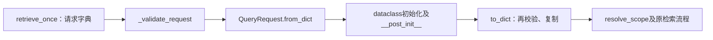

# Lesson 6：QueryRequest入口契约

日期：2026-10-11。目标：读懂字典怎样经过公共对象校验，再交给现有检索消费者。

## 输入与调用链

教学合成请求包含query="查历史用例"、scope_document_ids=["MOCK-CASE-001"]、exclude_document_ids=[]、candidate_k=20、max_context_chars=8000。



## 代码地图

| 函数 | 位置 | 职责 |
|---|---|---|
| retrieve_once | [retrieval.py](../../../naiyue_rag/retrieval.py)，第63行 | 请求校验成功后才检查资源、范围并进入Embedding |
| _validate_request | 同文件，第16行 | from_dict→to_dict兼容桥 |
| QueryRequest.from_dict | [types.py](../../../naiyue_rag/core/types.py)，第206行 | 核对恰好五个字段，cls(**data)创建对象 |
| __post_init__ | 同文件，第186行 | 显式检查类型/数值/列表，再复制列表 |
| to_dict | 同文件，第211行 | 对象可变，导出前再次校验并复制字段 |

## 关键机制

- @classmethod的cls在本次调用中是QueryRequest；cls(**data)展开为五个命名参数。
- @dataclass生成初始化方法，赋字段后调用__post_init__。candidate_k:int注解本身不自动拒绝字符串或转换数值。
- 显式检查要求candidate_k为非bool整数1–20；非法值抛request/invalid_candidate_k。字段集合错误则为request/invalid_request；失败发生在Embedding前，没有自动重试。
- 列表防御复制隔离调用方输入和对象；to_dict的复制隔离输出与对象，不代表对象自身不可修改。
- 字典→对象→字典统一入口校验并兼容旧消费者，不改变公开签名、检索算法或提高检索质量。
- 此处检查结构与值，是否有文档访问权限仍由resolve_scope负责。

## 本机证据

上一轮实际合成演示输出：

```text
object scope after input mutation: ['MOCK-CASE-001']
object exclusions after output mutation: []
invalid candidate_k: request invalid_candidate_k
```

上一轮实际命令`.venv/bin/python -m pytest -q tests/test_core_types.py::test_request_copy_and_roundtrip`输出`1 passed in 0.04s`。本轮只保存课堂记录，不重跑该命令；这是契约证据，不是模型、真实材料或检索质量结果。

## 理解检查与待复习

题目：candidate_k="20"被类型注解还是__post_init__显式检查拒绝？

用户原回答：**“是 post_init 里的显式检查，继续吧。”** 与源码一致，只登记该题引导后理解正确。未要求独立复写、尚未验证字段复制的独立解释或面试追问能力；目前无新增疑问。

## 下一步

进入M0 YAML配置加载切片设计：参考实际Settings加载链，说明当前资源配置如何装配给已有消费者，以及缓存身份/授权边界。
