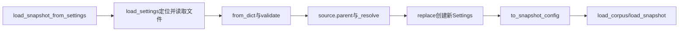

# Lesson 7：配置路径怎样到达资源加载器

日期：2026-10-11。目标：区分配置文件参数与文件内部资源路径的基准，理解路径如何传给真实消费者。

## 输入输出与调用链

教学配置文件为/tmp/rag-demo/config/local.yaml，内部dataset=../materials、corpus_run=corpus、vector_run=vectors、tokenizer_cache_dir=cache。输出分别为/tmp/rag-demo/materials、/tmp/rag-demo/config/corpus、/tmp/rag-demo/config/vectors、/tmp/rag-demo/config/cache。此为已有测试结构的路径教学，不是新建运行配置。

## 代码地图

| 函数 | 位置 | 职责 |
|---|---|---|
| load_snapshot_from_settings | [bootstrap.py](../../../naiyue_rag/bootstrap.py)，第13行 | 调用配置加载、转换旧字段、取全库ID、加载资源 |
| load_settings | [settings.py](../../../naiyue_rag/core/settings.py)，第154行 | 定位文件，读取/解析/校验，按配置目录解析资源 |
| _resolve | 同文件，第149行 | 绝对路径直接规范化，相对路径与base拼接后规范化 |
| Settings.to_snapshot_config | 同文件，第90行 | 分组对象转换为旧12字段供现有消费者使用 |

## 关键理解

- 相对配置文件参数按调用时cwd定位；文件内部资源按source.parent定位。这是两个不同基准。
- 换cwd仍找到同一配置文件时，其内部资源含义稳定；不同cwd使用相同相对配置参数不保证找到同一文件。
- _resolve的条件表达式展开为is_absolute检查→选path或base/path→resolve→str；Path的/运算是路径拼接。
- resolve只规范路径，不创建目录或证明资源存在。原加载器核对文件、正文版本和索引身份；分词器初始化才创建配置指定的缓存。
- frozen=True对象不直接修改字段，replace创建新分组，再创建新Settings，旧对象保留。
- to_snapshot_config把settings.snapshot.dataset变成config['dataset']，由load_corpus实际读取；runtime缓存路径直接传给load_snapshot。
- 配置失败先抛安全SettingsError并停止，不进入资源加载，没有自动重试。

## 验证与理解检查

上一轮实际命令`.venv/bin/python -m pytest -q tests/test_settings.py::test_relative_resource_paths_follow_config_directory_not_cwd`输出`1 passed in 0.16s`。测试使用临时合成配置，变更cwd后验证路径与不创建缓存；本轮不重跑，不当端到端/质量结果。

题目：配置文件/tmp/rag-demo/config/local.yaml、vector_run=vectors、cwd=/tmp/rag-demo/other，索引路径是什么？

用户原回答：**“/tmp/rag-demo/config/vectors，继续吧。”** 正确，只登记本题引导后路径判断。未验证独立复写、异常路径完整复述或面试能力，当前无新增疑问。

## 下一步

准备M0统一最小追踪Spec，沿参考TraceContext→TraceCollector及实际消费链核对，先说明成功/失败/持久化边界。
