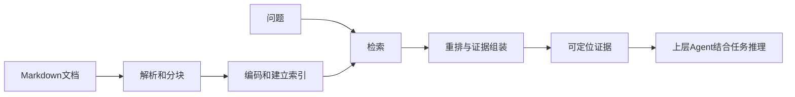

# Lesson 9：阶段B·1.1 RAG解决什么，检索和推理怎样分工

日期：2026-10-16。当前系统学习按六章34节推进；本节是概念入门，没有执行模型或修改源代码。

## 场景与输入输出

使用本仓库`examples/core-demo/knowledge/`的合成订单计费材料，非用户真实知识库。新需求移除折扣开关，保持基础金额计算；问题为“哪些历史需求和用例有助于确定回归范围？”

输入是问题及可选查询范围。检索核心输出相关原文片段、文档/片段身份、来源版本、真实定位及检索信息；上层结合新需求判断应改什么、应回归什么。历史TC-02的折后实付10只描述历史行为，不能直接作为新需求的预期。

## 概念

RAG是Retrieval-Augmented Generation，即检索增强生成：先找外部知识，再将选出的证据提供给生成模型。检索可用关键词、向量或其他机制；Embedding不是RAG的定义，也不等于用这些文档训练聊天模型。

- 文档：一份Markdown来源。
- 片段：参与检索和返回的较小内容单元；用例不能只截出一部分预期而丢掉前置条件。
- 索引：为了查找而预先构建的检索数据结构；不替代原文。
- 证据：带来源与定位的内容；被返回不自动证明相关、完整或仍有效。

## 数据流与边界

建库一般提前进行，查询按问题发生；新建库/文档变化时需要更新相应产物。它们的实际实现及版本绑定在后续章节展开。

正式代码`naiyue_rag/query/retrieval_pipeline.py::RetrievalPipeline.query`依次调用`search.search`、`reranker.rerank`、`builder.build`，返回证据，不生成测试用例或最终问答。当前LLM后端用于候选重排，不因此具备正式问答层。知识库Agent决定补查是后续阶段能力。

## 主要情况

| 情况 | 本节结论 |
|---|---|
| 返回相关证据 | 仍要由上层结合新需求判断适用性和缺口 |
| 历史用例和新需求预期不同 | 不能直接复制旧预期，保留历史来源供推理 |
| 返回空结果 | 表示当前检索路径未返回证据，不能证明全库没有答案 |
| 返回非空结果 | 不自动表示证据充分；当前answerability仍可为unknown |
| 网络或索引失败 | 应明确失败；项目双路任一路失败整次报错 |

## 学习证据与下一步

本节概念已在课堂讲解；用户理解待反馈。本人调试、复写及独立实现未评估。没有运行新测试；历史工程测试通过不替代学习证据。

下一节：1.2沿同一份Markdown和同一个问题，区分建库与查询两条数据流，说明每一步产生什么、保存什么、什么时候调用模型。
