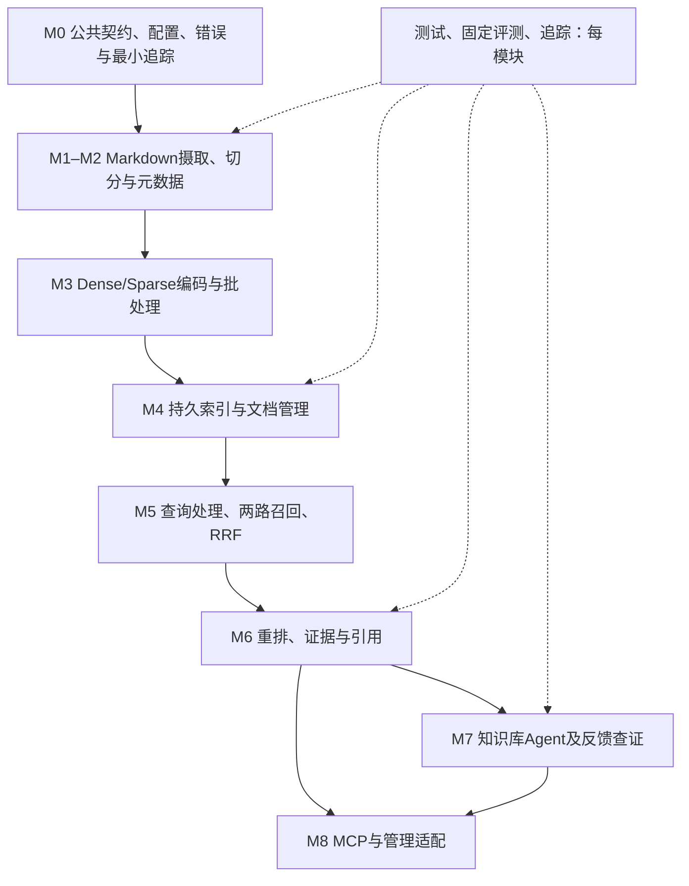

# 项目计划（讨论稿）

## 2026-10-26：三项优化的7片实现

用户要求把此前三项优化先写为7个分片Spec，讨论实际决策后按序实现；每片验证收尾时说明下一片准备怎么做。设计索引见[Spec0044–0050](specs/README.md)：查询清理1片→策略身份/中文切分2片→文档复用规划/快照账务/增量摄取/消费者收尾4片。

用户进一步授权连续完成全部分片，仅实际出现新决策时暂停。D1实际/raw查询指纹与最终证据schema2、D2中文标点归前块/新任务默认v2/旧包读v1、D3完整编码快照与独立本次报告均已按确认实施，7片实现和消费者接线齐全。第7片最终完整回归2235 passed in437.84s（0:07:17），扩展96 passed in92.60s，全部7片已通过本地验收。增量只编码变化文档，移除零编码，完整新双索引审计后激活；真实资料/模型成本/大库性能另验。阶段B六章讲解及本人6.5练习状态保持，不将优化测试通过当本人独立能力达标；Agent/MCP仍后置。真实配置/依赖/用户知识库未改；本轮已获明确提交/push授权，未发布或删除旧资产。

## 当前主线：按参考模块依赖推进（2026-10-11，已认可）

用户指出此前缺少持续开发主线、从Chroma局部接线推进过早。本节作为当前开发顺序的唯一入口；下文早期选型/实验记录保留。Spec0012即时Embedding准备暂停，不作为下一实施项。总体知识库Agent目标、A2基线和参考模块覆盖保持，每个模块再写自己的Spec和验收。

用户随后认可此路线，并明确本项目与参考基本一致：优先沿其模块骨架/主流程/已核实现与显式参数，集中适配Markdown、L0/L1/L2历史用例业务和上层知识库Agent策略；不另设计一整套替代框架，不重新选择已定方向。必要的兼容/定位/安全差异在模块Spec说明。

### 阶段边界（2026-10-15用户已确认，优先于下文早期节奏）

按“独立RAG核心 → 系统学习 → Agent与接入扩展”推进，M0–M9保留职责编号。长期覆盖参考模块的目标保持，阶段完成不宣称生产成熟。

| 阶段 | 范围 | 进入下一阶段的判据 |
|---|---|---|
| A：完成独立RAG | M1–M6及必要M0配置/错误/追踪；Markdown摄取、版本管理、新问题混合检索、重排、完整证据与引用；通过库接口及可重复命令独立使用 | 任意合规新问题绑定同一活动版本执行两路召回/RRF/重排/来源回取；范围、完整用例、空态/失败/预算明确；保留关闭重排基线、小型固定样本及失败分析；不依赖Agent/MCP/UI |
| B：系统学习RAG | 围绕阶段A已验证代码：全链路合同→解析/切分→编码→存储/版本→检索/重排→调试/验证，共六章，章节小节数随实际复杂度调整 | 按真实数据/测试/调试路线学习并分别记录理解证据；不以全部测试通过替代本人掌握；发现真实缺陷按证据修复；主要新功能开发暂缓 |
| C：扩展知识库能力 | M7知识库Agent、自反馈补查；M8 MCP/Dashboard和测试Agent接入；完整评测系统/Provider扩展；M9 PDF/图片/模型增强等 | 每项另写切片Spec与接线/质量验收，不要求同一阶段一次完成全部扩展；测试Agent仓库修改另按授权 |

完整课堂在阶段A暂挂，仅解释必要机制/设计分歧与验证结果；阶段B沿真实实现系统走读，不每片强制练习。学习状态与工程状态继续分开记录。

2026-10-15用户授权持续推进阶段A直至核心RAG完成：按当前模块顺序自主完成源码对照、Spec、TDD、接线和记录，不因切片结束反复等待“继续”。只在实际未定且影响行为/质量/成本的决策处讨论；真实.env/配置、发布/删除/push等操作仍遵循既有边界。

“评测扩展后置”指平台、任务管理、模型评分Provider和完整可视化；阶段A仍保留确定性测试、最小追踪、固定合成样本/基线及质量失败证据。人工标注、合成标签与模型评分分别记录。大规模真实资料验收、容量/部署/备份恢复/生产可靠性仍为独立条件。

阶段A以检索与证据核心为主要完成边界；单次问答生成可作为独立适配层补充，不成为学习RAG核心的前置门槛。大模型重排属于可选执行策略的确定流程，不因此引入Agent循环。框架/后端/参数沿已定路线，不借本次节奏调整重新选型或重写既有组件。

2026-10-16阶段A的M1–M6已完成当前本地工程验收，当前进入阶段B准备，从第1章完整查询合同开始。系统课堂尚未开始，不预填理解/独立实现。

M5.1–M5.5已验收。M6的Spec0041/0042 GLM与证据/CLI闭环已有真实合成结果；2026-10-16按用户确认完成单环境兼容依赖及Spec0043真实本地CPU/同池对照/CLI接线，新增模型API请求0。两种后端均有实现与实际消费，来源/预算/失败保留。最终全量2151 passed in404.22s，编译/依赖/字段与来源接线/锁文件核对通过；按既定顺序进入阶段B。真实资料质量、完全离线Embedding与生产容量仍未验。

### 1. 当前起点与复用方式

已有Mock摄取/切分、旧真实Embedding缓存、BM25/RRF/预算、关系/图路线对照、A2可调用快照、Chroma原生持久对照，属于技术选型实验和局部接线。最近一次全量验证493通过，本轮规划未重跑。

模块规划起点naiyue_rag当时只有4个源码文件；a2_snapshot/retrieval/chroma_store仍依赖experiments。随后M0三基础片新增公共契约、配置装配和查询追踪，状态见第4节。vector_index.load_corpus仍强制synthetic与naiyue-rag-mock-v1，公开入口仍依赖冻结资源。通用摄取、文档更新管理、产品重排、知识库Agent/MCP/Dashboard未完成，不能登记为完整产品框架。

现有源码与正负实验全部保留，按模块复用、提升并逐步消除核心对experiments的依赖。实验应消费核心或通过兼容入口对照，产品核心不反向依赖固定任务/标签。Chroma归入存储模块已有资产；不清空、重初始化、卸载或一次重写。

2026-10-14进入M4：[参考与现有存储核验](research/m4-storage-and-lifecycle-2026-10-14.md)和[Spec0028](specs/0028-m4-artifact-storage-and-lifecycle.md)已获接受，按完整资料包、正式Chroma、BM25S、活动版本/文档管理四片推进。M4.1已完成来源/成对编码存储与重载：91新增/1357全量通过，独立进程恢复完整DTO；无新模型请求。正式索引/活动版本与管理仍待后续片。用户授权在替换后清理无消费者旧代码，本片四旧模块仍被实验/回归消费，没有删除候选。

2026-10-15 [Spec0029：M4.2](specs/0029-m4-chroma-index.md)已按用户澄清改为同进程/允许共享.env并完成实施：正式包→VectorUpserter→Chroma→新进程审计/完整Chunk回读；32新增/1389全量通过。SDK内部维护写与业务只读分开，不因.env存在拒绝启动；合法配置共存、非法字段安全报错。无模型请求/依赖升级，旧适配仍有实验消费者。唯一下一步M4.3 BM25S源码对照与Spec；M5查询/活动版本待后续片。

2026-10-15 [Spec0030的M4.3](specs/0030-m4-bm25s-storage.md)已完成正式BM25S存储：同包tokens→构建/保存→另进程来源/行映射/矩阵/分数核验，空词片段保留；54新增/1443最终全量通过（此前232相关回归）。按第三次复用规则共用原私有KB路径校验，公开接口和原测试保持；无依赖/模型/真实.env变化。下一步M4.4同版本激活与管理Spec；scope统计与旧A2差异在M5范围检索前讨论。

### 2. 模块依赖

2026-10-15 [Spec0034：M4.7显式移除](specs/0034-m4-document-removal.md)已按用户继续授权实现并接线：稳定ID/revision→选定包保留集全量M2/M3/双索引→激活新版本，原文件/旧版本保留，不级联；再次主动摄取按新增纳回。切片160 passed in40.56s（78新增），四原生跨进程场景与既有消费者通过，全量1780 passed in201.57s；源/索引格式/配置/依赖保持。下一步先对照参考梳理M5查询链并制定M5.1 Spec，完整课堂暂挂。

2026-10-15 [Spec0033：M4.6摄取/更新Pipeline](specs/0033-m4-ingestion-and-updates.md)已实现/接线/本地验收：源合并保留历史、编码前复用、变化时全库重编码/完整构建后revision激活；当前用量/候选/激活状态在整次错误中保留。新增86 passed in 27.13s、全量1702 passed in 170.29s；真实组件跨进程首次/重复/更新和既有ID消费者通过，旧存储/测试/配置/依赖保持。下一步M4.7显式文档移除Spec；编码复用、真实资料与生产容量另验。

2026-10-15 [Spec0032：M4.5只读文档列表与详情](specs/0032-m4-document-management.md)已实施/接线/本地验收：活动元目录+规范资料包投影，携带版本、可选revision约束；两路健康仍由open_active检查。新增84 passed in 14.86s、全量1616 passed in 148.35s，四种原生构建场景跨进程管理读取及ID消费通过；原接口/测试/配置/依赖保持。下一步先做M4.6重复摄取与更新Spec；当前不是完整M4或业务质量通过。

2026-10-15 [Spec0031：M4.4同版本激活](specs/0031-m4-same-version-activation.md)已实施/接线/本地验收：三类真实audit→SQLite登记完整绑定/切换active，重启固定版本/配置；串行激活、revision、提交不确定与读IO失败明确区分。89新增/1532最终全量通过；模型/真实.env/依赖/旧索引无变化。下一步M4.5只读文档列表/详情Spec；文档更新/移除、M5查询与真实材料质量另验，完整课堂继续暂挂。



这是依赖图，不表示一次生成或并发执行。摄取建立可激活的一致索引版本；查询读取该版本；Agent在核心之上搜索/精读/补查。模块可以分多个切片，每片有真实消费者、异常测试及可演示路径。

### 3. 开发顺序与退出条件

| 顺序 | 参考对应模块 | 本项目工作 | 完成这一模块的判据 |
|---|---|---|---|
| M0 | Settings、types、Logger/TraceContext最小部分 | 集中当前已用字段、配置加载、校验、序列化与安全错误；保留旧API/dict兼容，只建有消费者的结构 | 配置真实加载并被调用；文档/片段/定位/查询/证据往返一致，非法输入明确失败；最小trace无秘密，不是空类或全厂商占位工厂 |
| M1 | Loader、FileIntegrity | 显式知识库范围内加载Markdown原文，分开逻辑文档ID/内容版本，记录实际位置 | 正常/空/非法编码/缺文件/越界路径/重复文档测试；去除强制Mock身份的产品限制，内容保留，不信手写行号 |
| M2 | DocumentChunker/Splitter、ChunkRefiner、MetadataEnricher | 成熟组件＋标题/完整用例行适配；规则清洗不覆盖原文；已有元数据/引用与需求用例配对保留来源 | L0/L1/L2和用例均可定位；维度/表头/前置/步骤/预期完整；异常表格/超限/坏引用有诊断；固定解析评测；模型派生增强另在M9对照 |
| M3 | Embedding Provider、DenseEncoder、SparseEncoder、BatchProcessor | 文档/问题编码共用模型与策略身份；配置选择服务/模型；沿参考批处理，复用当前分词/校验 | 数量/顺序/维度/NaN/零向量/超限/限流/超时可观察；身份匹配；真实调用与替身分账，无Key能跑离线契约，不默换模型 |
| M4 | VectorUpserter、BM25Indexer、DocumentManager | 纳入现有Chroma/BM25S；可重载的向量/关键词/原文目录；索引版本、重复摄取和更新管理 | 同版本ID/原文/来源对应；写入后重启查询；重复不增长；同文件修订与历史L2分开；某存储失败不能标整体成功或激活混合版本；查看/更新/删除状态与授权明确 |
| M5 | QueryProcessor、Dense/SparseRetriever、HybridSearch、RRFFusion | 查询规范化/范围校验→真实问题编码→同范围两路→融合；受控引用导航和原文补读 | 任意新问题走统一入口、不依赖四题查询缓存；各路/融合去留可追踪；空/异常分开，默认不隐式单路降级；旧A2可对照 |
| M6 | CoreReranker、LLM/CrossEncoder、ResponseBuilder、CitationGenerator | 重排必做、两类实现分别切片；固定候选池对照；完整结构化证据与引用/整体响应预算 | 重排真实接线，关闭基线可比较；ID不超候选/范围；失败明确；引用绑定实际版本/位置；完整用例不截断，整个工具返回与context_text分别限额 |
| M7 | 本项目新增知识库Agent、Self-RAG启发反馈 | 独立任务上下文中的搜索/精读/解释/比较/缺口补查，服务四类场景 | 固定任务的证据/未知/终态可追踪；轮次/范围/累计预算/重复动作有程序限制；主上下文/总延迟/质量对照；不宣称原论文训练复现 |
| M8 | MCP Server/工具、Dashboard六页面 | 同一应用服务的受控适配；总览/数据浏览/摄取管理/摄取追踪/查询追踪/评测 | 真正客户端调用、异常/取消/范围验收；管理不绕过校验直改索引；空数据真实为空；测试Agent实际接入另按授权，不自动改其他仓库 |
| M9 | PDF/图片、Caption/Storage、MultimodalAssembler；模型Refiner/Enricher；评测Provider扩展 | Markdown主线稳定后补参考多模态/派生增强，Custom/Ragas/Composite消费实际结果 | 内容/页面/图像来源与派生映射；增强/未增强对照；模型评分不当人工标签；原文不被覆盖；其他Provider逐个接线 |

测试、追踪、评测贯穿M0–M9：解析看内容/结构/位置；检索看片段与证据范围召回/排序；Agent与问答看主张支持、缺口及交接；工程看配置/版本/失败/延迟与实际用量。M9只是扩展评测Provider，不能等到M9才建立评测。

部署、并发/取消、备份恢复、容量成本与安全权限按相关模块及使用场景加固，是独立生产验收条件。真实材料在另一机器，先用Mock/边界样本验证工程，再提供可迁移验证入口；远端结果单独登记，不承诺短期覆盖全部长期目标。

2026-10-11用户明确首期内部共享，不做按用户/角色/文档权限控制，不作为当前模块完成门槛。配置入口默认加载知识库全部可检索源，scope/exclude为任务过滤；不扩展原底层权限接口。后续若有隔离或HTTP/MCP入口访问需求，到实际阶段再讨论。

### 4. 第一个模块与推进纪律

M0分小片：先[Spec0013公共数据契约](specs/0013-m0-core-contracts.md)，再[Spec0014配置装配](specs/0014-m0-settings-loading.md)、[Spec0015最小查询追踪](specs/0015-m0-minimal-tracing.md)。三片已授权实现并对当前A2消费者验收，最新63新增/660全量，无新依赖；配置/旧结果保持，成功失败追踪及显式JSONL真实接线。范围限定当前冻结资源与串行查询，不能声明全产品/生产成熟。

路径小课已收尾，用户正确回答config/vectors，仅引导题理解。Spec0015写失败保留结果策略明确接受，已实施验证；下一课追retrieve_with_trace失败控制流，随后准备M1 Markdown加载Spec。M0当前消费者基础退出条件已具证据；摄取/管理/并发消费与通用资源仍按后续模块接入。

随后用户要求先进行M1，追踪课暂挂。[Spec0016通用Markdown加载首片](specs/0016-m1-markdown-loading.md)已获接受并完成库级验收，当前学习与下一步以handoff顶部及学习地图为准；不把加载成功当成新文档索引/查询或完整摄取成功。

用户继续M2并确认结构/业务保护与参数化路线。Spec0017–0019结构/规则与显式关系已验收；[Spec0020](specs/0020-m3-encoding.md)编码按独立正式入口建设（[ADR0005](decisions/0005-formal-encoding-entry.md)取消实验兼容）。Spec0021输入合同、0022 SDK/Dense和[0023正式Sparse](specs/0023-m3-sparse-encoding.md)已接线，Spec0024成对BatchProcessor亦已接线，最新97新增/1101全量；真SDK+模拟HTTP与真jieba分账，不当真实服务或检索质量通过。Spec0025正式QueryEncoder/QueryEncodingResult也已离线接线，最新66新增/1167全量。用户先开发，Lesson8走读暂挂；[Spec0026](specs/0026-m3-supervised-service-check.md)监督验收现已完成：55新增/1266全量通过，真实embedding-3两次HTTP200/三条2048维向量/91tokens，属于当前编码范围验收；生产调度/检索质量不在此承诺。课堂暂挂，不强制练习。M4参考对照和Spec0028现已形成，M4.1现已离线验收，唯一下一步为M4.2正式Chroma的SDK/.env边界及接线Spec。

不一次建立全目录/空类，不全面替换字典，不顺手改unit_id或公开签名。兼容回归先立住，Loader/Chunker随后消费同一契约；公共类型按消费者逐步增添。

每模块固定流程：定位上下游→核参考与现有代码→列复用/差异→Spec与验收→红灯/最小实现→真实接线/小型集成/固定评测/旧回归→课堂与练习→对照退出条件再进入下模块。用户希望继续时，复述不设为强制阻塞；自述与独立实现分别记录。

长期路线已认可，Provider版本、持久映射与权限在对应模块Spec定稿，不作为一次性全模块实施授权。现有功能状态区分实验已验证/局部已接线/当前模块范围验收/生产未验收。M0三片真实实施状态见上述Spec，未修改真实运行配置或调用新服务；后续模块先说明范围再Spec/TDD。

## 历史选型与实验记录

以下保留2026-10-10及此前讨论的来源和阶段状态；不作为当前开发顺序。总体目标/三层边界见[ADR0004](decisions/0004-knowledge-agent-goal-and-boundaries.md)，参考映射见[目标架构](research/target-architecture-and-module-map.md)，当前主线以本文开头M0–M9为准。

用户本轮明确希望覆盖Modular参考项目的模块，用于生产能力建设与面试学习；在知识收集占用主Agent上下文为主要问题时，建议验证主Agent→知识库Agent→RAG核心三层。用户指定名称“知识库Agent”，覆盖用例设计、问题排查、知识问答、自动化用例对文本用例的知识理解；它负责文档解释/比较和查证，主Agent负责用户任务、现场验证及最终行动。底层A2混合检索与上层多轮知识任务兼容，但固定缓存实验尚无新问题产品API；端到端效果另测。摄取/检索/重排/证据/MCP/追踪/评测/Dashboard/分层测试纳入长期能力清单，PDF/图片进入后续模块学习扩展；当前业务材料仍为Markdown。模块覆盖目标不等于每次请求全启用，不声明现有实验已产品化或生产通过。具体三层契约、主Agent意图/工具选择、阶段与实现仍待讨论/Spec，核心不依赖上层Agent；本轮不修改测试Agent项目。

用户随后确认记录讨论并准备建设：总体方向不再重复选，反馈思想参考Self-RAG的检索需要/材料相关/主张支持/任务效用，工程适配用可观察结构化检查与程序停止边界；不复现训练或继承论文成绩。先从一次A2新查询/可追溯证据入口的小切片开始，不一次生成整个项目。数据库、运行框架、远端CPU模型和真实服务验收仍按具体阶段决定。

用户已确认第一轮并列验证A“片段检索＋已有引用/名称关系”、B“LightRAG图＋片段”，见[ADR 0001](decisions/0001-retrieval-experiment-scope.md)。此确认限定实验路线范围，具体解析组件、模型/存储、预算及实现仍待实验Spec。[摄取组件比较](research/markdown-component-experiment.md)列出三个切分候选及共享片段接法的静态证据。

用户补充模型环境后，首轮安排在当前电脑，用合成Mock、智谱embedding-3及用户指定glm-5.2，见[ADR 0002](decisions/0002-experiment-machine-and-embedding.md)。两种标准API短样本接入已实测；生成探针第三次通过本探针结构/合成事实检查，LightRAG及检索尚未接线。真实材料电脑不能使用该API；CPU本地Embedding留到后续核验，不阻塞当前实验设计。最终部署模型未定；更换模型须独立重建向量并重跑评测。当前结果不能代替远端真实验证。

当前仍在技术选型讨论。用户指出助手在材料核验后过早转向解析切片/Spec，现已纠正顺序：文档结构与候选证据的确认不代表自写解析器、框架、检索机制、存储或开发切片已获选择。先用已收集的材料特点及定向调研比较候选、解释取舍和最小选型实验，再确定阶段Spec与实现。下文切分、定位及数据流建议用于评价候选，不作为已批准开发方案。

选型讨论先比较检索机制：关键词、向量、已有引用/名称关系补充、模型抽取图谱分别如何服务历史需求/旧用例与回归证据查询；这些机制可以组合，不把框架名当算法。随后比较实现组织：少量Python自有逻辑、复用LangChain/LlamaIndex组件、适配完整知识库产品，各自满足证据契约所需的修改、依赖、运维与学习成本。Embedding/Rerank/LLM及存储在对应需求明确后单独讨论。选型实验只验证候选，不自动扩展为完整产品开发。

用户进一步要求指定Modular参考项目持续参与选型，尤其比较文档拆分、现成解析组件复用及自有框架逻辑的边界。因此本轮先讨论摄取组件复用取舍，再回到检索路线；不是排除参考项目或预定全部自写。[参考项目补充源码核验](../research/naiyue-rag-knowledge-base/deep/modular-rag.md)显示其组合MarkItDown/LangChain splitter与自有DocumentChunker及流水线。当前建议优先验证“成熟组件复用＋本项目文档语义/证据规则”，完整自写与LlamaIndex整体编排均保留为对照。该推荐不等于选定具体解析库、框架、存储或模型，亦不授权进入功能Spec和开发。

用户随后指出整体选型不能仅比较两个摄取框架：实际需求需要多份历史需求及多层文档共同组成证据。现已补充[跨文档路线比较](../research/naiyue-rag-knowledge-base/report.md)：Modular基础召回及已有关系扩展、LightRAG图+片段、Microsoft GraphRAG Local/Global和RAGFlow平台各自保留具体角色。跨文档不自动等于需要自动图谱，也不能预先排除图谱候选；组件复用只是摄取层建议，尚未获具体路线选择。选型需评价证据集合完整性、关系依据、版本、定位及代价，不只比较单一相似片段。

本轮[定向调研报告](../research/naiyue-rag-knowledge-base/report.md)已记录组件、完整平台、图谱和托管路线的静态实现/文档证据，待用户审阅。下文保留首期讨论框架，实际样本与最小实验之后再固定技术选择。

## 问题与边界

主要服务另一条线的测试 Agent：将用户提供的既有用例、需求文档和方案设计等 Markdown 建成知识库，让 Agent 查询证据、回答问题，并据此辅助设计新用例。RAG 核心负责可定位的证据检索；用例设计和 Agent 控制仍在上层。本项目也可有独立的大模型问答适配层，但答案质量与检索质量分别验证。未来计划通过 MCP 暴露给 Agent，接入阶段再定接口和授权边界。首批用户材料的来源、敏感性、可用于本地实验的范围仍需逐份确认；无授权材料时可用合成样本验证机制，不把合成结果当业务基线。

### 已明确的主要业务任务

长期目标是摄取整个现有Markdown知识库并保留文档关联，作为模型/测试Agent的检索工具。新的需求通常会整理成新的L2，模型写用例时能看到本次需求文档及L2；新增服务也可能只有新的L1，直接以L1生成用例。它调用知识库寻找相关的历史需求和历史用例，接收可追溯片段作为参考，再由模型自行推理编写用例。也需要支持仅有自然语言任务描述、没有指定文档的入口。回答知识问题仍属目标范围。

RAG负责历史参考证据检索及关联内容补充；本次需求作为任务依据、历史需求与用例作为参考的角色需明确保留。若新L2已加入索引，历史参考检索需能区分本次需求和历史材料，避免只返回本次需求而误判历史检索成功；具体范围/排除条件在Spec中定稿。模型生成的用例质量是上层评测，不能由检索命中或格式正确代替。

保留历史需求是业务要求。必须区分“同一文件正文修订后替换旧索引片段”与“不同L2代表不同历史需求”：索引更新不能把所有旧L2一律当过期材料删除或排除。返回历史证据时保留需求/用例类型、来源、日期/版本及定位，不能把旧用例的预期自动当成本次需求的正确预期。文档是否失效/替代仍需明确材料依据。

用户进一步确认历史材料保留当时内容：新需求往往只改变原功能的一部分，剩余相关功能需要回归，因此检索须支持找回历史行为及对应用例。此确认针对当前讨论的历史需求/用例，不改变此前新增L2后更新相关L1、必要时更新L0的约定。历史内容命中不自动证明现行有效：需结合本次改动与其他相关变更，区分已改变行为、未改变且可能需回归的行为、有效性尚不确定的行为；该判断由上层模型结合证据及人工确认完成，RAG保留来源并提供证据，不凭日期或相似度直接裁定。

### 已知材料结构与实验单位

用户说明及三张照片确认以下材料结构。已查看截图中的可见片段，尚未读取远端Markdown原文件或验证完整语料：

| 层级/结构 | 已知含义 |
|---|---|
| L0 | 整个系统的宏观描述，包括数据流、链路等 |
| L1 | 服务或模块的功能导航，保存功能简要说明及对应L2引用；按L1根目录归组，截图还显示服务/功能子目录 |
| L2 | 每次新增需求；所有L2文档放在一个文件夹 |
| 文档表头 | 有概括描述、对应内容的行号标注，以及上层和下层文档引用 |
| 目录和关系 | 目录按层级分组，但目录结构不提供文档一一对应关系；显式关联来自表头引用 |

截图确认引用使用Markdown链接，目标为相对文件路径；部分链接后附章节编号及`L起始-结束`的正文行范围。L0正文小节可链接到L1模块文档；L1表头有上级文档、概括/摘要和带行范围的章节索引；L2表头有需求编号、变更日期、所属模块、前置依赖、变更基线、摘要及来源，且一个L2可以引用多个L1。这些是截图中的结构观察，不保证所有文件格式相同；仅记录通用结构，不抄录业务正文或原始截图到仓库。

用户报告部分文档表头标注行号与正文实际行号不一致，具体偏差及原因未在本机复现。设计要求：证据定位以读取时原文件的实际物理行号及标题路径为依据，并绑定该次源文件版本；表头手写范围仅作导航提示，不能直接作为证据位置或切分边界。可核对的偏差须显式报告，未核对标为未知，不静默当正确。若无法从章节/标题唯一找到目标，不只凭失准行号截取或猜测修正，不自动改写用户源文档。后续清洗/切分如改变文本，必须保留到原文的映射；原文件更新后重新计算定位。

用户进一步确认：有新的L2后会更新相关L1，必要时更新L0，但L1仅保存功能简述及L2引用，不包含替代全部L2的完整需求细节。理解需求仍应结合相关L0/L1/L2内容；实际查询按任务所需章节组合证据，不默认读某一层就足够。对照实验需评估多文档证据是否找齐，而不只看是否命中一份相似文档。

用户说明L2由需求文档整理而来，对本次需求的功能描述通常相对完整，包含改动点、实现说明和相关边界条件。可以将其作为本次需求的主要说明，再沿引用补充模块/系统背景；不能由此推断一份L2已完整覆盖整个模块所有功能、包含所有其他需求或自动替代此前L2。尚未直接检查这些内容，具体完整性和多需求冲突规则须在样本中核对。

表头及正文的显式引用可作为文档关系提取和核对的依据，不应先用模型猜测已经写出的关系。需要保留上级/详细文档/前置依赖等关系含义，不能统一误当严格一对一父子树。相对路径是否有效、章节是否存在、手工行范围与目标正文是否一致，仍需在另一台机器验证；截图不证明解析器已实现或引用已接线。层级标签与时间字段也不自动决定文档有效性或业务权威性。多份需求的保留/替代关系仍是后续待核验项。

用户确认历史用例是独立文档，和需求文档放在L2文件夹下，可以按名称对应，例如`L2_A.md`与`L2_A_测试用例.md`。新增服务可能尚无L2，以L1生成用例，其名称同样可与对应L1匹配；不能强制所有用例必须关联L2。L1来源用例的具体路径和命名格式、标题与文件名是否始终一致、重名/缺失等情况尚未检查。文档层级（L0/L1/L2）、内容角色（需求/模块说明/测试用例）与关联来源须分别记录，不能仅依据所在目录把用例识别成需求。

用户确认用例正文先按测试维度组织，每个维度对应小标题，标题下是表格，一行一个用例；各用例含自己的用例标题、前置条件、测试步骤、预期结果等。候选切分单位为完整用例行，并保留所属维度/标题路径及表格列名，避免把步骤和预期拆散或丢失列含义。同一维度可包含多条用例，不默认整张表作为一个片段。原始用例行、列名及维度标题的来源位置须能区分，组合展示内容不冒充一段连续原文；具体输出契约在Spec中讨论。超长用例不静默截断，超限行为须明确。

已查看用户新提供的用例源码照片：可见二级维度标题，其后有块引用形式的来源/覆盖说明，再跟管道表格。可见列为序号、用例名称、前提条件、测试步骤、预期结果、等级、设计者、测试结果、备注；单元格含`<br>`、行内代码、强调及公式。编辑器行号显示各用例为独立长源码行，屏幕折行不等于文件换行。个别后续用例显式引用前面用例的部分开关/配置条件，说明完整表格行也可能依赖其他用例；需保留这种引用，不能静默声称该行前置条件已自足或自动继承被引用用例全部内容。评价候选解析能力时检查原文与维度说明是否保留；依赖识别、解析/补充及预算作为选型需求讨论，不提前实现完整用例依赖系统。照片右侧有裁切，未获得完整原始文本，不据照片验证所有列或分隔符；尚未确认全库转义竖线等特殊写法。不抄录照片中的真实业务正文进入仓库。

候选机制是先提取已有链接及命名配对关系，再在检索命中相关内容后补充对应文档的有关片段；名称关系说明用例针对哪份文档，不自动证明它与本次任务相关，亦不要求整份关联文档全部返回。配对依据应可追溯，无法唯一匹配时显式标为缺失或歧义，不凭模糊名称静默绑定。此机制尚未实现、接线或验证。

用户确认L2引用L1，但不会显式列出本次功能对应哪些历史文档/历史状态，具体改动需要读内容理解。因此L2→L1链接表示背景或依赖，不可当作“修改/替代了某份历史需求”的证明；共享L1只能作为相关候选线索，不能证明功能相同或规则仍有效。候选检索流程应利用本次任务内容找历史片段，结合L1导航/已有引用补充相关候选，再利用用例名称配对补充参考。内容比较形成的变更、替代、回归判断属于推断，须保留支撑出处及不确定性，不自动写成已确认的知识库关系。此确认不是已对全库链接形式做穷尽核验。

样本应选一组有层级或业务联系的文档，并包含需要多份证据的问题，避免只用互不关联的文件评价方案。验证时先画出真实文档关系和预期证据，再确定比较的两三种检索方式；分层信息的利用、跨文档补充和自动知识图谱是不同设计候选。当前不因为存在跨文档问题就认定必须采用某个图谱框架。

真实文档在另一台机器上。后续由本会话提供可复制的提示词或验证代码，用户在那台机器的AI中执行；先核对结构和关系，再跑所确认的对照实验。此处不假定能访问远端文件、不要求将整份真实材料搬到本机；用户转述结果、远端命令/原始输出和本机直接验证分开记录。具体环境和模型调用预算到实验前确认。

用户提出两种实验协作方式：本机写实验代码，经GitHub同步到文档机器跑真实材料；或按照片在本机构造结构相近的Mock材料。用户已认可先用Mock、后用同一实验代码验证真实材料的协作建议，并明确授权根据现有照片生成Mock文档。本轮授权为样本资产准备，不作为编写RAG或实验实现、安装依赖、调用模型、创建/推送GitHub仓库的授权。

已建立[Mock v1](../examples/mock-v1/README.md)：knowledge内12份完全合成Markdown（L0系统说明、L1三模块导航、历史需求/用例、本次任务及词汇重叠的干扰材料），另有manifest和4个助手构造的讨论任务。任务列出11个实际原文行范围证据单元，绑定源哈希；不是检索chunk ID，也不是用户人工金标准。资料说明、manifest、tasks不属于摄取范围，避免预期证据泄漏。样本结构与位置校验通过，未运行RAG实验。

Mock须标为合成，并区分照片可见结构与助手补造内容。可验证格式与确定性机制，不能据此裁定真实语义召回、图关系收益、回归证据齐全、规模、延迟或费用。完整结构应覆盖L0/L1/L2、用例、引用、部分变更、无直接链接关联及干扰材料；未显示内容不冒充原文。若用户愿意分享，经远端审阅的脱敏Markdown文本比照片更利于保持结构/长度/转义，仍需记录脱敏对检索语义的影响。

真实材料保持在文档机器，运行前核对其系统、Python及候选依赖支持；不能承诺所有候选跨系统兼容。本机先修常见路径/编码/配置问题，远端失败由用户回传脱敏命令、错误及版本信息，助手继续定位修复；不要求用户独自维护第二套代码。实验结果记录代码版本、依赖、材料/索引版本和候选配置，使后续换文档可重复比较。费用预算、服务范围及GitHub发布具体目标在实际操作前明确。

已准备[远端小样本只读核验提示词](research/remote-markdown-sample-inspection.md)，用于核对一个任务的文件结构、显式引用、名称配对和内容相关候选。用户已提供两张远端AI报告截图；本机已查看可见内容，未直接读取远端原文或核验其实际命令。用户认可本轮讨论的历史计算公式及对应旧用例一定程度上需要参考，这是相关性确认，不是逐条行范围已校验、全部候选齐全或人工金标准完成。报告指出有未深入读取的候选及当前L1包含后来变更，不将其建议“以当前L1为准”升级为权威规则；仍须结合相关L2证据。没有算法对照或RAG质量结果。

## 建议的首个 MVP

建议先以少量用户确认可用的关联Markdown模拟一份新需求/L2任务，样本含其背景文档、相关及无关的历史需求、历史用例。先验证文档读取、可定位切分、**一条可复现的历史参考检索路径**、结构化证据及固定评测集；后续再扩展全库。首期不做 PDF/网页、融合、重排、MCP 或界面。Embedding 与独立 LLM 问答何时进入切片，需结合本轮调研和真实材料问题确定。此前“先关键词、后向量”只是候选，不是已确认方向。

### 数据流与契约草案

```text
Markdown 文件 + 知识库范围
  → 解析并记录源文件/版本/标题/行号
  → 切成可定位片段并分配稳定 ID
  → 建立首个索引
查询文本 + 知识库范围 + top_k
  → 范围内召回 → 排序 → 结构化证据（或空结果/明确错误）
固定查询 + 人工标注的相关片段 ID
  → 同一索引版本运行 → 每题结果和聚合指标 → 失败案例
```

查询输入拟含 `query`、`scope_id`、`top_k`。每条证据拟含 `document_id`、`chunk_id`、`source`、`version`、`location`（Markdown 行范围及标题路径）、`text`、`retrieval_method`、`rank`、`score`。分数只在同一路径同一索引版本内解释，跨算法不直接比较。无结果返回空证据和成功状态；输入无效、索引不可用或 IO 失败须分别报错。具体类型与 ID/更新策略在首阶段 Spec 定稿。

### 技术候选与取舍

| 选择点 | 候选 | 本期倾向与前提 | 最小验证 |
|---|---|---|---|
| 首期材料 | 用户提供且确认可用于本地实验的 Markdown；合成 Markdown 作为机制探针 | 真实需求/方案/用例优先用于业务评测；合成样本仅验证确定性机制 | 先检查少量材料的来源、敏感边界、结构和可标注问题 |
| 首条召回 | 确定性关键词/BM25；本地 Embedding 向量；付费 Embedding API | 关键词离线基线优先，学习/成本低但同义表达弱；向量能测语义召回，增加模型、索引和运维成本 | 在同一固定集比较 Recall@k 与失败类型，仅变更检索路径 |
| 索引载体 | 进程内/文件；SQLite FTS；专门向量库 | 用能支持首期路径的最小载体，不预装向量库；SQLite FTS 的中文分词能力须单独验证 | 重启后同一查询结果、重复摄取和更新测试 |
| 编排 | 自写少量 Python；LangChain/LlamaIndex 组件 | 首期倾向直连小模块以看清数据流；框架可在重复需求出现后评估 | 对照一条调用链的代码量、定位保留和错误可见性 |

开发与运维上，离线路径最易复现、无外部服务；代价是语义召回与规模表现未知。付费模型或服务性能、成本、token 指标未测，不能提前填写数字。中文材料决定分词和位置映射实验，不能把英文词项结果外推。

### 建议验收口径（待材料确认后定数值）

下列是项目的实验验收，由助手实现检查、对照与报告；用户参与确认材料含义、真实问题和相关证据标注。不是要求用户在开始前独立证明能力或完成测试代码。

通俗含义：①进入索引的片段完整保留原文且能找回出处；②检索使用正确模块/层级范围及已确认的有效版本，不误排掉有关的上层或跨模块证据；③同一组真实问题重复运行能核对找全、遗漏、无关结果及无答案，并比较方法差别。具体自动断言和人工检查在样本明确后写入Spec。

- 解析/切分：人工逐篇检查标题、正文、行号和引用定位；片段正文可回溯到源文件对应行，空文档/编码错误明确失败。用例表格需保留完整用例及维度/列名，不混合相邻用例的步骤和预期；表头行号偏差不覆盖实际原文定位。真实表格语法与超限策略确认后在Spec写具体断言。
- 摄取/更新：相同内容重复摄取不增加可见片段；同一文件正文修订后的索引版本按已确认策略替换，不误删其他历史L2和用例；失败状态不冒充完成。存储策略确定后写具体测试。
- 检索：固定问题按**片段级**人工标注相关 `chunk_id`。每题 Recall@k = top-k 命中的相关片段数 / 该题全部相关片段数；对可回答问题做宏平均。无答案问题另算“返回空或明确证据不足”的比例，不和 Recall 混在一起。首期阈值在看过材料与标注后确定。
- 主要业务检索：分别标注本次任务相关的历史需求和历史用例证据，核对类型及背景是否找齐；覆盖指定L2/需求文档入口、仅任务描述入口、没有相关历史参考、历史规则与本次需求差异。加入新需求只修改部分功能的样本，标注应召回的原功能及回归参考证据；是否正确生成回归用例由上层另行评测。找不到历史用例时不编造用例引用，不用本次需求的自命中填补历史检索成绩。
- 工程：同一数据、索引和配置可重复跑出结果；记录入口、输入范围、索引版本、候选数、耗时和明确失败原因。单元测试全绿只证明指定行为，不等于业务质量达标。

## 后续阶段（计划，不是承诺）

1. 在固定集上加入第二路召回，比较关键词与向量；确认 Embedding 模型/接口、维度与预算。
2. 加融合，再单独加重排与上下文预算；每次只改一个变量并保留失败样例。
3. 扩展更新/版本一致性；PDF/网页解析仅在后续出现材料需求时讨论。
4. 可选问答层：引用存在性与主张支持、证据不足；按测试 Agent 的实际调用需求设计 MCP 适配。
5. 按真实使用证据逐步补齐权限、追踪、异常恢复、性能和成本控制。
6. 知识图谱已纳入选型实验候选，未作为已选首期功能。显式引用与名称关联、模型抽取关系分别评价；LightRAG图+片段可与基础路线并列验证，不要求先证明基础检索失败才讨论。引入产品须依据可标注关系任务、来源与版本保持、质量及代价证据决定。

## 待用户决策

当前建设状态（2026-10-10）：总体方向见ADR0004，Spec0010已完成可调用A2，Spec0011已完成Chroma1.5.9持久写入/重载/范围/来源与A2对照。当前唯一下一步是ChromaStore.query小课；真实材料/标注、动态Embedding、多后端/Agent与生产能力仍按阶段推进。下列五组研究结果为此前实验阶段记录，不覆盖最新handoff。

1. A1/A2/A3/B0/B1五组范围已确认并完成本轮运行。最新410测试通过，B1真实112 HTTP、237/305全库图与53/72单scope图、原文/来源/向量绑定审计、无Key标准重放结果/评价字节一致。首live审计bug失败保留，完整产物标engineering_revalidation且只补Q03两请求；不是原失败目录改成功。B1 Q01覆盖2/8同B0，Q02召回1/5→0/5，当前配置无收益/退化。唯一下一步汇总五组做首期技术路线取舍，真实材料/人工标签验证仍待；不重问已定模型/Key/预算、不直接做MCP。
2. embedding-3/2048维和glm-5.2来源已确认，Key复用已授权；A1实际5请求、16条批次、56向量/7472输入tokens已验证，无Key零网络重放一致。不重问型号或金额门槛。私有原文外发、CPU部署和生产索引不在本轮，不改真实.env。
3. 用户允许扩大返回上限，助手将五组共同上限调整为8000；Q01全部必要证据含检索信息5357字符，格式可容纳8/8，实际成绩仍需运行。旧4000约束与结果保留为历史，基线仍分开记录候选/预算遗漏。合成标签非全部人工审阅，真实阶段再确认远端样本、标注及保密范围，Mock结果不能代替真实业务验证。
