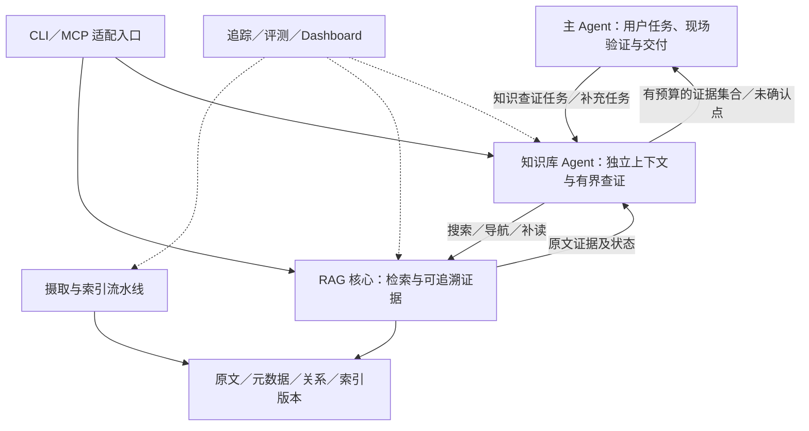

# 目标架构与参考模块映射

## 2026-10-11：当前路线与成熟度核对

用户要求按参考模块依赖建立连续开发路线，纠正此前局部接线推进。开发顺序以[project-plan当前主线](../project-plan.md)为唯一入口：M0公共契约/配置→M1加载→M2切分/清洗/元数据→M3编码→M4索引/管理→M5查询/融合→M6重排/证据→M7知识库Agent→M8MCP/管理→M9格式/模型增强扩展。追踪/评测从M0起贯穿，不最后补。

用户随后认可主线，并明确本项目与参考几乎一致，主要差异为Markdown、知识库Agent策略及业务处理。按参考模块骨架/主流程作为默认，保留已认可的A2/BM25S/来源/兼容/安全适配，不从该表另造整套架构。M0先沿dataclass契约，后YAML配置/最小追踪，具体第一片见Spec0013。

本轮只读核参考main `f658c5a4011c8b826707a65a3b11ce9301b0626f`，工作区干净；基于本机固定快照，不宣称本轮刷新远程HEAD或运行参考测试。重新读取README/DEV_SPEC/pyproject/settings及相关源码。参考模块事实与当前本项目状态分开：

| 参考模块与真实接线 | 本项目已有资产 | 当前缺口与归属 |
|---|---|---|
| core/types.py的Document/Chunk/ChunkRecord等dataclass与dict往返；settings.load_settings读取YAML→from_dict→validate | Spec0013公共类型、Spec0014配置装配、Spec0015查询追踪，660总测试 | 三基础片对当前消费者已验收；只配置有消费者字段，核心逐步独立于experiments，未成通用配置/资源框架 |
| IngestionPipeline构造完整性、PdfLoader、Chunker、Refiner/Enricher/Caption、编码和存储组件 | Mock加载、内容/位置与组件探针 | 通用Markdown Loader/摄取编排未完成，M1–M2；PDF主入口须适配本业务 |
| DocumentChunker→Splitter，Transform在编码前调用 | evidence_units/markdown_checks保留标题/维度/完整行及上下文 | 当前适配受Mock和固定结构限制；引用/规则与通用文档模型需纳入M2 |
| EmbeddingFactory→DenseEncoder/SparseEncoder→BatchProcessor | 标准HTTP真调用探针、索引/查询旧缓存、jieba/BM25S | 无产品Provider与统一编码模块，M3；SDK未安装，协议和费用需实际核验 |
| VectorUpserter写Chroma，sparse统计chunk_id随后改为vector_ids，再BM25Indexer.add_documents；后续才完整性成功登记 | ChromaStore独立原生对照、BM25S持久实验 | 无统一双索引版本/目录/更新状态，M4；顺序写入不是原子提交证明 |
| ingestion/document_manager.py聚合文档/索引/图片管理 | 仅冻结资源加载 | 产品查看/更新/删除管理未实现，M4；保留历史L2与同文件修订区分 |
| QueryKnowledgeHubTool装配QueryProcessor、两路Retriever和HybridSearch | retrieval/A2Snapshot与旧算法入口 | 依赖experiments和Mock缓存；任意新问题/统一Chroma查询应用入口未完成，M5 |
| HybridSearch调用RRF；仅一路非空时返回该路原分数；有单路错误fallback | 已验证等权RRF/显式错误策略 | 复用已定A2参数，保留正常空路和故障区别；M5不复制隐式降级 |
| MCP工具execute先search，可配置调用CoreReranker，再ResponseBuilder | 原文/预算组装已有实验 | 重排尚无产品实现，M6必做；响应/引用须成为公共证据而非仅实验文本 |
| ResponseBuilder.build生成引用/Markdown/可选图像，没有此处聊天LLM调用 | 已有证据字段与位置核验 | 知识解释是M7独立应用，不能把参考格式化叫成问答生成已验证 |
| TraceContext/Collector供流水线及工具消费；EvalRunner消费HybridSearch，可注入reranker/answer_generator | Spec0015七阶段/成功失败报告、显式JSONL收集及IO失败状态；实验状态/用量/固定评测 | 当前查询最小追踪已接线；摄取追踪/管理/并发与统一EvalRunner未完成，Provider扩展M9 |
| scripts/evaluate.py实例化EvalRunner时未传reranker/answer_generator | 自有固定范围/片段评测 | 评测入口必须与实际配置路径一致，不能只存在类；真实集/人工标签仍待 |
| MCP协议/工具与Dashboard六页面消费核心和数据/追踪服务 | 本项目尚无MCP/Dashboard | M8以同一应用服务接入；不绕过范围/版本，空数据不伪造 |

以上为源码阅读事实，未在本轮安装/调用参考服务。现有493测试为之前本机记录，不等于模块成熟度。所有模块应记录存在、实质、实际调用、该模块集成/质量边界；当前总项目尚无真实业务/生产验收。

目录布局借鉴参考的core/libs/ingestion/query_engine/observability/interface职责；在实际实现模块时建立必要文件，维持本项目包与公开兼容入口，不先生成全部空目录。现有实验用作对照资产，逐模块使核心独立于experiments，不整体搬迁重构。

Spec0012即时Embedding准备已暂停，后续归到M3编码模块和M5查询模块规范，不继续把模型接线独立当全局主线。

当前M0实际进度：Spec0013/0014/0015公共契约/配置/查询追踪三片对现有消费者已验收，最新63新增/660全量。新core源码不导入实验，bootstrap/旧资源/算法仍按主线迁移；配置限冻结资源，追踪限本机串行查询，不覆盖摄取/管理/并发或其他模块缺口。

日期：2026-10-10。用户已确认建设以RAG为核心的知识库Agent、覆盖Modular模块、思想参考Self-RAG，正式决定见[ADR0004](../decisions/0004-knowledge-agent-goal-and-boundaries.md)。优先目标包括知识收集对主Agent上下文的占用；四场景包括用例设计、排查、问答及自动化理解。本文的目标与分层已确认；具体接口/后端/阶段实施仍按Spec落实，不声明模块已经实现或生产验证通过。

## 1. 参考核验与证据边界

- URL：[MODULAR-RAG-MCP-SERVER](https://github.com/Jerry-ai-dev/MODULAR-RAG-MCP-SERVER)。本机只读目录：`/Users/zmw/MODULAR-RAG-MCP-SERVER`。
- 分支main；完整commit `f658c5a4011c8b826707a65a3b11ce9301b0626f`，提交日期2026-03-06。本轮2026-10-10的`git ls-remote origin refs/heads/main`与本机HEAD相同，工作区`git status --short`为空。未fetch/切换/修改该仓库。
- 重新读取README、DEV_SPEC、pyproject和实际摄取/检索/响应/评测源码。静态调用链：`IngestionPipeline.run`→完整性检查→PdfLoader→DocumentChunker→refine/enrich/caption→BatchProcessor→VectorUpserter→BM25Indexer→图片/完整性登记；`QueryKnowledgeHubTool.execute`→HybridSearch的查询处理/两路召回/RRF→可选CoreReranker→ResponseBuilder/CitationGenerator→TraceCollector。
- 该快照`ResponseBuilder.build`格式化证据和引用，不调用聊天LLM；`scripts/evaluate.py`装配EvalRunner时未注入reranker或answer_generator。因此README的“生成”目标不能视为独立问答实际服务已证明；[既有详细调研](modular-rag-mcp-server-2026-10-09.md)保留其他配置/定位/错误/评测边界。
- 本轮没有安装/运行参考项目、第三方Skill、测试或模型服务。源码接线不等于真实质量/可靠性。pyproject声明MIT，根目录未发现独立LICENSE/COPYING；本次只借鉴设计，未来复制代码前核对授权文本、范围和来源。

## 2. 目标与选型状态

长期目标：覆盖参考的摄取、索引、查询、重排、证据响应、模型适配、MCP、追踪、评测、Dashboard和分层测试能力；加入本业务需要的Markdown语义/定位、文档关系/历史、知识收集上下文隔离。PDF/图片作为用户提出的完整模块学习与扩展目标进入后续阶段，当前业务材料仍为Markdown，不要求为了模块齐全让每次查询经过所有可选步骤。

已确认三层目标：主Agent（当前为测试Agent）→知识库Agent→独立RAG核心。知识库Agent作为本仓库上层应用，RAG核心也可独立调用/评测且不依赖它或测试Agent。测试Agent工程保持独立，本轮不修改。总体建设方向已授权，三层具体契约/路由/框架按切片落实，不登记尚未实施能力。

箭头表示调用/消费关系，不表示每次全部执行或互相依赖。MCP可提供低层检索和高层证据收集入口；两个入口共享核心/范围/证据契约。协议不决定Agent循环位置。Dashboard通过应用服务管理摄取并读取状态，不能绕过校验直接改底层索引。

## 3. 完整模块映射

下表是建设目标；阶段已按2026-10-11的M0–M9主线更新，唯一开发顺序见project-plan.md，不代表完成状态。各Provider具体实现和后端型号在对应模块Spec选择，不为列出能力创建空接口/占位模块。

| 参考模块／职责 | 我们的对应能力与区别 | 建议阶段 |
|---|---|---|
| Settings、核心Document/Chunk/Result类型 | 配置真实加载、类型/序列化契约、文档身份与源版本分开；字段全链路同步 | M0 |
| Loader、FileIntegrity | Markdown先行，实际原文位置/编码诊断；重复摄取同时考虑源版本、处理策略和Embedding身份，不只SHA跳过 | M1 |
| DocumentChunker、Splitter | 复用成熟Markdown组件＋标题层级/完整用例行适配；维度、表头、前置条件引用有出处；超限不能静默切断一个用例 | M2 |
| ChunkRefiner | 规则清洗与必要时派生检索文本；原文不可被LLM改写覆盖。保存原文、派生版本与映射，失败显式 | M2规则／M9模型 |
| MetadataEnricher | 先提取文档已有标题/层级/模块/需求编号/引用；模型标签或摘要标为派生候选，不裁定业务有效性 | M2规则／M9模型 |
| DenseEncoder、SparseEncoder、BatchProcessor | Embedding批处理/用量/失败，BM25分词统计；绑定模型/维度/语料/策略版本，不混表示空间 | M3 |
| VectorUpserter、BM25Indexer、持久存储 | 向量后端推荐优先验证Chroma，文件精确检索保留对照；关键词复用BM25S。向量/关键词/元数据可重载，更新一致性/恢复验收，具体版本/部署另Spec | M4 |
| DocumentManager | 查看/版本/更新/删除管理；保留历史L2，与同文件修订分开；多存储删除及恢复显式报告并按授权执行 | M4 |
| QueryProcessor | 清洗与词项提取；可选有界改写/子问题实验。显式查询范围不能被模型扩展，原查询保留 | M5 |
| DenseRetriever、SparseRetriever | 同一允许范围内两路召回；独立报告错误、命中与耗时，单路降级有标识，不装作正常混合结果 | M5 |
| HybridSearch、RRFFusion | A2作已测基线，保留每路/融合/预算去留；显式引用定位与补读单独观测，不强制重用负向A3路由配置 | M5 |
| CoreReranker、CrossEncoder/LLMReranker | 用户明确必做的重排模块；启用可配，基线仍保留。固定候选池验证收益/延迟，CPU/API/LLM实现比较；不能修复输入池外漏召回 | M6 |
| ResponseBuilder、CitationGenerator | 结构化原文证据及实际位置优先；区分正文、上下文、派生摘要和检索信息；不以摘要替代证据 | M6 |
| 多模态响应、PdfLoader、ImageCaptioner、ImageStorage | 后续PDF/图片内容、页面/区域出处与描述映射；caption为派生内容，不能当原图事实；用公开/合成材料验收 | M9 |
| Embedding/LLM/Reranker等Provider与可替换组件 | 必要边界真实可换、有契约与异常测试；先实现已选择Provider，具体更换前做最小接入/质量验证；不一次仿制每个厂商适配 | M3／M6／M7／M9按实际Provider |
| MCP Server、工具注册、collection/summary工具 | 分开搜索、预览/关系、指定原文补读、可选收集证据入口；直接客户和Agent均可消费。STDIO/远程传输按场景选，权限范围不靠参数自报 | M8 |
| Logger、TraceContext、TraceCollector | 摄取→查询→知识收集→交接可关联；记录真实配置/Provider、错误/降级/预算，不默认写敏感正文或全量模型过程 | M0起贯穿所有模块 |
| Custom/Ragas/CompositeEvaluator、EvalRunner | 原文内容/定位、检索覆盖/排序、收集完整性、问答支持度分别评测；有真实调用及角色标签，模型评分不冒充人工标签 | 各模块固定评测／M9扩展Provider |
| Golden set、Unit/Integration/E2E | 原文范围/章节/用例与版本标签，固定基线/逐题失败；工程接口测试、真实服务、远端材料和业务效果分账 | 每模块 |
| Dashboard六类页面 | 总览、数据浏览、摄取管理、摄取追踪、查询追踪、评测面板；查询追踪下钻Agent轮次/证据去留/预算，空数据真实为空 | M8 |
| DEV_SPEC与开发辅助Skill | Spec/TDD/教学/来源记录/可复现验证；按需要借鉴开发流程，不自动运行第三方setup/auto-coder/package或发布 | 每模块 |
| 可选基于证据问答层（参考声明目标） | 独立Answer应用、主张与引用支持验证、证据不足；共用证据集合，不把格式化响应当生成回答 | M7知识解释／M8独立问答适配 |

## 4. 本业务新增的关键职责

### 4.1 文档关系与历史

显式Markdown引用、需求/用例配对及文档层级是可追溯关系；保留来源、关系类型和目标解析诊断。模型抽取关系另存为派生候选；图是扩展候选，不因模块覆盖目标默认启用LightRAG。当前L1与历史L2角色不同，检索排名/日期不能证明旧预期仍有效。实际章节定位绑定源版本，手写表头行号只作导航提示。

### 4.2 与A2的关系

三层架构兼容A2：知识库Agent每次搜索可调用同一范围内的Dense＋BM25→RRF→有预算原文证据。多轮委托/导航/补读是上层能力；重排、自动图谱不是维持A2所必需。当前A2的query/scope/exclude→search/keyword_search/fuse/pack_evidence源码链已核对。

现有hybrid_probe是固定任务与缓存实验，核验query_hash并从缓存读取查询向量，尚无接受任意新问题的产品API。后续需复用已有检索逻辑并补新查询Embedding/错误/预算/接线契约，不直接把CLI实验标为Agent可调用。动态子查询和新场景必须重新评测，不能继承原四题指标作为端到端质量证明。

### 4.3 知识库Agent应用与主Agent边界

建议共享本项目检索核心，维护独立任务消息历史：接收明确知识目标与必要材料→提出/执行搜索→导航与精读→解释/比较文档规则与历史变化→识别查证缺口→有界补查→原文引用核对→返回有依据发现、证据及未确认点。它不是只返回片段的工具；文档解释和局部知识推理属于它的职责。

| 场景 | 主Agent负责 | 知识库Agent负责 |
|---|---|---|
| 新需求测试设计 | 澄清任务、设计维度/用例与回归优先级 | 历史规则/旧用例/依赖/边界查证及原文支持 |
| 问题排查 | 取得并验证现场日志/代码/接口状态，形成实测根因结论 | 查文档中的预期链路/配置/异常条件，给出有依据解释与待验证假设 |
| 知识问答 | 理解用户问题、组织最终回复与必要澄清 | 文档检索、规则解释、跨文档比较、引用与证据不足 |
| 自动化用例 | 选择框架/运行环境、编写与运行脚本 | 解释文本用例前置/步骤/预期中的业务语义及引用条件；缺失API/断言依据显式报告 |

以上是职责草案。知识库Agent只使用受控知识检索/导航/读取工具，不默认运行现场检查、修改需求/知识库、编写或执行测试。主Agent根据证据决定业务行动；文档知识不能证明现场某次故障的真实原因。最终交付和用户对话由主Agent协调，需要补充输入时知识库Agent返回缺失问题，由主Agent向用户澄清。

不复制主Agent全量历史；携带任务必要原文引用、已确认事实及来源，并把观测/假设分开。任务内允许多轮查证，跨调用补充任务通过受控证据引用/任务状态衔接；不默认建立无限增长的知识库Agent聊天历史。全任务与内部循环均有停止边界。

框架按该应用需求选；可优先比较熟悉的Agent框架实例与有界工作流，不自行重造通用Agent runtime，也不导入另一个仓库的会话/UI/环境。客户端、进程和模型Provider的部署方式不与“独立上下文”绑定。

### 4.4 主Agent意图识别与调用草案

优先采用主Agent既有模型的任务理解和工具选择，配合明确知识工具描述/输入契约；首期不额外引入意图分类Agent。主Agent先确定最终目标，再检查是否缺少本系统的业务知识、历史依据或跨文档解释；通用解释/已充分给出证据的机械处理可直接进行，内部系统规则不能靠模型记忆臆造。显式用户要求、业务流程必需查证点和权限由规则约束，模型负责语义判断/提出知识目标；工具入口再做确定性参数/范围/预算校验。不是只凭关键词路由。

四类场景是调用背景/输出组织信息，可以混合；同一任务可能同时问规则、排异常、理解用例。不用四个互斥意图标签代替实际子问题，也不让主Agent预先完成所有知识搜索规划。主Agent负责“要弄清什么”，知识库Agent负责“怎么查清楚”，核心负责“按契约检索/读证据”。

建议主Agent面向一个高层知识工具（暂名knowledge_query，未确认API）：目标/待确认问题、场景背景、必要材料或带版本的文档引用、已有事实/假设及来源、请求范围/排除材料、预算和先前证据引用。预算由服务上限限制，实际可读范围是请求范围与服务端授权交集，模型传参不能扩大权限。

返回：有证据引用的发现/解释、必要原文或完整用例、未确认/冲突/缺失输入、可补读引用、任务/语料版本、完成/部分/失败/取消等终态与停止原因、真实可观测用量。主Agent判定是否足以完成自己的任务；部分结果不装作全库已查全。初期不把所有底层检索参数都交给主Agent，也不返回子Agent全部搜索历史。

调用过程：用户任务→主Agent识别知识缺口→结构化工具调用→入口校验→知识库Agent独立查证并调用A2/读取工具→有预算结果回填→主Agent继续交付或提出具体补充任务。初期允许任务有依赖时等待结果；后台作业/并发是后续独立接入决策。

一手模式参考：[LangChain Subagents](https://docs.langchain.com/oss/python/langchain/multi-agent/subagents)描述将子Agent包装为工具及输入/输出上下文隔离；[Tools](https://docs.langchain.com/oss/python/langchain/tools)描述名称/说明/schema对工具选择的作用。仅作为模式依据，未据最新网页升级本机框架或宣称已装配/实测。

路由验收：内部业务问题应查却未查、已知信息充分却反复查询、缺少定位信息时未澄清、混合意图误分流、越界参数被拒绝、失败/部分结果正确交付都应留固定样本；另评委托问题质量、引用支持、四场景知识覆盖、主上下文与总延迟。不给没有实测的路由准确率。

### 4.5 证据与上下文预算

- 原文Evidence：文档/片段/用例身份、源版本、实际位置、正文、上下文来源、检索方法/排名；没有统一分数时保留null及语义。
- 收集结果：任务与语料版本、按子问题组织的发现及原文引用、必要完整用例、未确认点、终态/停止原因/实际用量。模型判断与原文分开，推断不能标成事实。
- 证据保存：中间候选/正文可保存在受控外部记录，主Agent按有权限且绑定版本的引用补读。交接结果与补读均有预算；不以多个小响应无限累加。
- 收集状态需区分目标完成、达到预算但仍有缺口、取消、失败；检索空候选不自动证明全库无答案。不假造“覆盖充分”评分。

### 4.6 Self-RAG作为知识查证反馈参考

用户明确要求参考Self-RAG，已完成[定向论文与源码调研](self-rag-2026-10-10.md)。原方法有特殊reflection tokens的训练与解码/候选生成选择，不能把通用模型JSON自检称为原算法复现。当前建议借鉴需要检索、材料相关、主张支持与任务效用四类检查，将它们放知识库Agent既有分析步骤；A2仍为底层检索，不新增第三个Critic Agent。

知识库Agent补查应有明确证据缺口与下一动作，也可补读当前材料、请求输入、保留未知或移除无依据主张。身份/版本/位置由代码校验，语义支持为模型判断待实测；累计预算/截止/重复动作控制由程序保证。固定基础循环与增加自检循环作单变量对照，检查误补查/漏补查、支持误判、必要覆盖、主上下文与总延迟；不因为模型自评“支持”就记为业务通过。

### 4.7 Chroma/关键词实现与重排、失败策略

文件精确检索是当前可复核基线，不是最终存储约束。推荐下一向量后端优先验证Chroma：同原52向量/单元与模型身份，仅替换Dense后端，保持BM25/RRF/证据预算；查持久重载、ID/版本映射、范围过滤及top-k相对精确基线的差别。旧结果不删除/覆盖，不把换库当必然质量提升；本轮没有安装/运行Chroma或确定版本。

官方[Query/Get](https://docs.trychroma.com/docs/querying-collections/query-and-get)允许query_embeddings，因而可显式沿用我们自己的Embedding；[元数据过滤](https://docs.trychroma.com/docs/querying-collections/metadata-filtering)支持where。客户端实际范围仍来自服务端授权与请求交集，数据库过滤不代替授权。[Python客户端文档](https://docs.trychroma.com/reference/python)把PersistentClient定位为本地开发/测试，生产建议server-backed；阶段接入模式与真正部署验收分开。旧参考collection/配置写法须按最终固定版本核对，不直接复制过时参数。

参考源码的QueryProcessor处理规范化、过滤语法、jieba分词和关键词约束；BM25Indexer自有统计/倒排/评分/保存。从教学定位可推断自写有助展示机制，但没有证明其比成熟库更好或作者具体选择原因。我们建设同样职责的模块，优先复用当前Tokenizer/请求范围和[BM25S](https://github.com/xhluca/bm25s)，自有部分集中在标识符/否定与边界语义保留、一致分词、索引/元数据映射和追踪；不为了模块名重写评分。

重排已由用户明确列为必做能力，关闭重排保留基线是实验/运行开关，不表示模块可省略。Cross-Encoder/API/LLM型号在对应Spec比较，中文材料、完整用例长度、CPU与延迟另测，不同时改候选召回再归因重排。

当前默认失败显式抛出、不隐式降为单路已由用户认可。future fallback若需要，配置/实际retrieval_mode/failed_routes/reason及质量状态都需可观察；无候选是正常结果、后端失败是错误、预算未返回是第三类，不混淆。字段仅是未来契约草案，当前代码尚未新增。

## 5. 两条数据流

摄取：Markdown→原文快照/元数据/引用→结构与完整用例→可选派生检索内容→Dense/BM25→持久索引候选版本→一致性校验→显式激活。索引构建/更新用量与查询成本分开；不声称快照方案已实现。

查询：主Agent任务→知识库Agent独立上下文→查询/允许范围→两路召回/RRF→可选重排/引用补读→有预算原文证据→知识库Agent解释/补查或停止→有预算证据交接→主Agent完成用例/排查/问答/自动化任务。每个可选步骤可关闭并作对照；下层不调用上层，不让检索核心隐含另一个自主循环。

## 6. 阶段与完成证据

1. **P1：Markdown检索核心与人工标签基线。** 复用已测组件/证据实验，补真实结构/完整用例/关系/定位/持久化的产品契约。原文、范围、错误与配置可核对，重启/重复摄取通过。已有合成A2不等于P1已完成。
2. **P2：独立上下文的知识库Agent最小对照。** 四场景各留固定任务，先选一个小切片；同任务输入/语料/模型比较主Agent直接调用与委托查证，观察必要证据覆盖、交接细节损失、主上下文峰值或可观测代理、累计读取/实际用量/端到端时间。合成可先验证机制，真实材料仍留远端；主上下文降低不能掩盖质量退化。
3. **P3：检索优化与知识库生命周期。** 重排、派生增强分别单变量实验；文档更新、索引一致性、失败恢复和删除管理有明确路径及验证，CPU部署Embedding独立选型。不承诺每个优化都会提高质量。
4. **P4：接入、管理与运行验证。** MCP与实际客户端、Dashboard六类页面、扩展追踪/评测、可选问答；按部署场景验证认证/范围/路径/凭证、超时取消/并发、恢复和备份，不凭模块存在声明生产级。
5. **P5：PDF/图片的完整模块扩展。** 在公开/合成材料上验收页面/图片定位、caption溯源和多模态返回，与Markdown分别报告。网页是另一个既有长期目标，不把PDF组件存在视为网页已支持。

以上P1–P5保留为2026-10-10的历史能力分组，不再作为开发顺序。当前执行顺序以project-plan的M0–M9为准：先建立公共契约和摄取链，再编码/索引/查询/重排/证据，再知识库Agent与外部适配。各模块用最小实现和退出条件推进，不要求一次补齐最终生产细节；两条学习线共享投入时间，不承诺短期全量交付。

## 7. 生产与面试证据

“模块已实现/已接线/已验证”分开；离线测试、真实服务、真实材料与规模/部署结果分开。生产建设重点是版本与范围一致性、错误/降级可观察、真实配置接线、资源预算、更新恢复和固定业务评测。验收数值由实际基线与需求确定，不预写指标收益。

面试学习每个模块形成一条可讲调用链：输入/输出→真实代码→失败案例→对照与取舍→本人复述/修改/复写。模型辅助完成不记为用户独立实现；不能复制参考README简历示例的规模、准确率、时间收益或贡献。

## 唯一下一步

总体方向无需重新确认。当前先审阅project-plan中的模块主线与M0最小范围，再写公共契约/配置模块Spec；已有Spec0010/0011与实验保留，Spec0012即时接线暂停。重排必做与默认显式失败保持；各模块内部接口/参数/后端差异在对应Spec落实。
