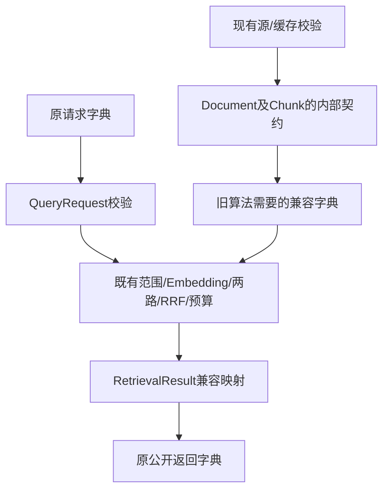

# Spec0013：M0第一切片——公共数据契约与旧入口兼容

日期：2026-10-11。状态：M0第一切片已实现并验证。用户认可M0–M9主线，明确参考优先，在具体方案说明后授权“好的继续吧”。本切片落实M0数据契约；配置加载与最小追踪是M0后续切片，M0整体尚未完成。实施证据见第11节。

实施前用户要求先说明准备怎样做，已说明类型/兼容/消费者/验收，随后获继续实施授权。以下设计记录保留；不以原准备段落覆盖本节最新状态。

## 1. 参考与当前调用链

参考URL https://github.com/Jerry-ai-dev/MODULAR-RAG-MCP-SERVER，main固定commit f658c5a4011c8b826707a65a3b11ce9301b0626f。本轮只读types.py、settings.py和trace_context.py，工作区干净，没有运行参考服务或复制其代码。

参考types使用dataclass、to_dict/from_dict，Document(id/text/metadata)、Chunk(id/text/metadata/start_offset/end_offset/source_ref)、RetrievalResult(chunk_id/score/text/metadata)被摄取/查询/响应消费。ChunkRecord在编码后使用，ProcessedQuery在查询处理后使用。settings为YAML→Settings.from_dict→validate_settings；当前PyYAML6.0.3已经安装，无需为后续YAML加载新增依赖。

本项目当前A2Snapshot调用experiments加载源/索引，units为完整字典；retrieve_once内部验证请求字典、检索/融合/预算后返回字典。公共接口、字段、unit_id和旧结果有回归。当前资源加载依赖Mock限制；本切片不提前修改Loader或索引协议。



## 2. 本片目标与边界

用参考的集中dataclass契约方式整理当前已用结构，并在现有A2Snapshot/retrieve_once形成真实消费者。核心新模块不导入experiments；旧资源加载/算法暂保持，按M1–M5逐步迁移。

本片不创建ChunkRecord/ProcessedQuery或所有Provider占位类，不写Loader/切分/Embedding/索引/重排，不改现有公开函数签名，不改变文件ID、源版本、原文位置、算法/排序/预算或历史缓存，不安装依赖、读取/修改真实.env、运行模型或删除迁移数据。M0完整模块尚未完成，不能把本片验收写成M0全部可用。

## 3. 类型与兼容契约

### 3.1 SourceSpan

采用现有span五字段：start_char/end_char/line_start/line_end/source_sha256。字符偏移0基、左闭右开；行号1基且含两端。拒绝bool冒充int、负值/倒置/空字符范围、无效源hash。保留当前字典字段，不重算/改写位置。检查与真实原文一致仍由现有资源加载负责，本类型负责结构和上下游表达。

### 3.2 Document

沿参考id/text/metadata。source_path与source_sha256为当前业务所需元数据，角色/层级等保留为已有字段。文本保持原样，允许空文档由M1明确处理；不在类型构造中读取文件或推断业务关系。

from_source_record(source)将现有源记录映射为Document：document_id→id、text→text、relative_path→metadata.source_path，其余合法JSON来源信息完整保留。类型供A2Snapshot的文档/片段引用核对使用，不在原文中拼额外说明，不改变原源记录协议。

### 3.3 Chunk

沿参考id/text/metadata/start_offset/end_offset/source_ref。from_legacy_unit(unit)映射unit_id→id、body→text、document_id→source_ref、body_span偏移→start/end。SourceSpan与源hash、位置一致性可核。

旧unit的20字段必须无损保留：schema_version/unit_id/document_id/source_path/source_sha256/role/semantic_level/directory_level/kind/heading_path/body/body_span/contexts/case_id/case_fields/component_metadata/eligible/diagnostics/rendered_text/rendered_characters。兼容映射保存这些字段，to_legacy_unit()返回同样的完整dict；不改字段名、ID算法或rendered_text，不把contexts/用例列压成字符串。无上下游需求时不新增字段。

### 3.4 QueryRequest

本项目边界类型，沿现有5字段：query/scope_document_ids/exclude_document_ids/candidate_k/max_context_chars。from_dict/to_dict复用当前验证语义和安全错误码：query非空且≤3072 UTF-8 bytes；scope可None或非空不重复ID列表；exclude为不重复ID列表；candidate_k为非bool整数1–20；预算为非bool整数1–8000。未知字段拒绝，不裁切或补隐式默认。

这里验证结构，授权仍由resources.resolve_scope校验，不让dataclass或模型参数成为授权来源。retrieve_once._validate_request调用此类型后返回原字典，外部签名/语义不变。

### 3.5 RetrievalResult

沿参考chunk_id/score/text/metadata，内部映射当前向量/关键词/融合候选：unit_id→chunk_id、body→text，其他原文和检索字段无损保留。from_candidate/to_candidate必须保持原candidate字典数值与字段一致，不丢distance/reference_similarity/score_kind/retrieval_info/rank。

分数只接受有限数值，不把bool/NaN/Inf作为合法score，也不将原始cosine限制为[0,1]。当前A2三种候选采用有限score；本片不迁移B1 native_order/score=None路线，旧实验不受影响。该路线需要进入产品时再扩正式契约，不能误称已支持。

## 4. 校验、序列化与错误

沿参考to_dict/from_dict思路，用标准库dataclass和显式校验，不新增数据框架。from/to边界做防御复制，metadata只保留可JSON表达的结构，禁止默认str转换或静默忽略字段；序列化拒绝非有限数值。业务文本/元数据不进入默认repr或错误日志，不解释文档中的指令。

旧dict键序可用私有桥接信息保留，但该信息不属于业务数据，也不进入公开序列化或dataclass值相等比较；类型→dict→类型应保持同等业务值。

兼容映射中已拆成主字段的旧别名不得同时出现在metadata：Chunk的unit_id/body/document_id，RetrievalResult的unit_id/body/score。冲突会造成转回旧格式时覆盖，因此明确拒绝，其他合法JSON扩展字段完整保留；该规则不改变当前合法旧输入。

将现有RetrievalError定义移至core/errors.py，旧retrieval模块及包导出继续引用同一类，保证类型身份、stage/code和错误字符串兼容。新增契约错误使用固定code，不包含输入值/原文/文件/凭证；入口映射为当前request/resources阶段错误，源/缓存原有失败类别保持。没有新网络层、重试或隐式降级。

## 5. 真实接线

- A2Snapshot资源校验完成后用Document/Chunk表达已验证源和公共单元，并核对片段的源ID/hash；canonical_units返回兼容dict给既有算法，后续原文证据不变。
- retrieve_once._validate_request实际使用QueryRequest；请求拒绝仍发生在Embedding回调前。
- retrieve_once对需要输出的向量/关键词/融合候选使用RetrievalResult的兼容往返，不仅创建类供测试调用；selected/budget_excluded/union等路径字段一致。避免仅转换最外层而漏掉嵌套返回。
- 本片不将ChromaStore切到新数据模型或搬迁实验函数，保持已有31个SDK替身与原生对照验证。Chroma纳入统一M4时再消除相关实验依赖。

## 6. 沿用与差异

| 项目 | 沿参考 | 必要差异及已确认依据 |
|---|---|---|
| 数据结构组织 | dataclass、集中类型、dict往返 | 保留既有公开dict/ID格式，通过兼容映射逐步使用，遵守不随意breaking change |
| 位置与来源 | Document/Chunk关联，metadata可扩展 | Markdown实际span与源版本为必要证据，不能照搬可缺位置；字段使用现有值 |
| 分数 | RetrievalResult存score/text/metadata | 原cosine/词法/RRF尺度明确，不把全部分数叫归一化概率；有限性/类型校验沿既有要求 |
| 配置格式 | 后续M0切片用参考YAML/分组dataclass | 本片不写未消费全配置表或真实settings，Key采用显式环境引用/传入，遵守项目凭证规则 |
| TraceContext | 后续M0最小追踪沿参考阶段记录/生命周期 | 只记录安全状态与ID/hash/长度/用量等必要字段，不直接复制原文到日志 |

以上适配落实已有来源/兼容/安全约定，不重新选择整套架构。若实现发现公开输出必须改动，先改Spec并讨论，不能默默迁移。

## 7. 影响文件

约7个业务/测试文件，加文档同步：

- 新增naiyue_rag/core/__init__.py：真实类型/错误导出。
- 新增naiyue_rag/core/types.py：SourceSpan/Document/Chunk/QueryRequest/RetrievalResult及必要兼容映射；≤500行，超过先更新Spec拆分。
- 新增naiyue_rag/core/errors.py：稳定错误身份/安全code；无实验依赖。
- 修改naiyue_rag/a2_snapshot.py与retrieval.py：真实消费、兼容输出；包旧导出保持。
- 新增tests/test_core_types.py与tests/test_core_contract_wiring.py：类型/全链兼容/异常/复制边界。
- 文档同步README/Spec/handoff/学习图；不新增真实配置或一次创建后续模块目录。

## 8. TDD与验收

先运行新测试确认缺模块红灯，再最小实现。不得改旧断言/skip失败；新测试准备字段按明确契约生成，新增规则若破坏已有合法输入必须先复议，不伪造通过。

验收包括：

1. dataclass结构与dict/JSON往返；真实旧源/52unit/完整用例转回相同字典，无重算ID/位置/渲染。
2. 缺必要字段、非法span/hash、bool/NaN/Inf、未知请求字段、非法预算/范围结构明确失败，错误不含原文。
3. 输入/输出及metadata修改不污染源对象、类型或资源；全部嵌套证据与检索信息保留。
4. 同一公开入口实际消费契约，非法/越权请求回调调用0；旧四题候选/selected/预算结果与原A2一致，trace/错误身份兼容。
5. 旧493测试全部运行，新增测试和Chroma原生对照回归；core新增模块不导入experiments，不声称其余旧依赖已全迁。
6. compileall/pip check/git diff --check，源码≤500，旧依赖/原文/缓存/结果hash不变；应用构建不适用，无服务/模型/部署/push。

拟执行命令：.venv/bin/python -m pytest -q tests/test_core_types.py tests/test_core_contract_wiring.py；随后pytest -q tests、compileall -q naiyue_rag experiments tests、pip check、git diff --check。这些命令尚未在本片运行，不预填测试数量/输出。

## 9. 兼容与回退边界

只调整内部表达和校验消费者；旧load_snapshot/retrieve_once参数、包导出、外部dict结果与索引文件保持。若原合法数据不能无损往返，停止在契约层定位，不改旧产物/放宽断言。回退设计为继续现有内部路径，任何实际回滚/删除仍需按权限规则确认；本文不执行这些动作。

## 10. 状态与下一步

该节原为设计确认边界，现已获授权并完成本片；唯一下一步先讲解实际QueryRequest调用与复制/校验机制，再设计M0 YAML配置加载。不跳回Spec0012即时模型接线，不将本片完成记为M0完整完成。

## 11. 实际实施与证据

实际7个源码/测试文件与清单一致，core/types.py263行、errors.py13行、core/__init__.py6行，retrieval.py113行、a2_snapshot.py116行；测试也≤500。新模块只依赖标准库和core.errors，不导入experiments；其余旧加载/算法依赖保持阶段计划，不冒称全部核心独立已完成。

TDD：新增两测试模块因缺naiyue_rag.core产生2收集错误；最小实现后46 passed in1.37s，旧全量加新增539 passed in50.28s。收尾发现私有键序桥接信息影响dataclass值相等：新增回归预期红灯，实际失败差异仅_legacy_order；两处桥接字段加compare=False，字段/旧键序保持。最终47 passed in1.34s、全量540 passed in50.04s，无旧测试/断言/helper修改。

随后字段保留检查发现metadata保留别名可能在转回时被主字段覆盖；新增回归出现DID NOT RAISE，源端拒绝Chunk的unit_id/body/document_id及结果的unit_id/body/score冲突，其他扩展保留。该修复后最终48 passed in1.35s、全量541 passed in51.83s。前述47/540是较早一轮验证，当前终态以48/541为准。

真实L3接线：load_snapshot→已核源/索引→A2Snapshot构建11个Document/52个Chunk并校验文档引用/hash/原文切片→canonical_units转回原字典；retrieve_once→QueryRequest.from_dict/to_dict→旧授权/Embedding/两路→各路及融合/union经RetrievalResult.from_candidate/to_candidate→原预算输出。selected/budget_excluded由已校验候选产生，完整上下文/用例字段保留，不只是外层类型声明。

旧四题真实向量缓存下dense/sparse/hybrid候选、selected、budget_excluded、context_text及指标字段与原A2一致；无新模型请求。旧错误导入身份api.RetrievalError、retrieval.RetrievalError、core.errors.RetrievalError为同一类。非法/越权请求的Embedding回调调用0，所有类型/输入/输出复制边界有回归；score_kind缺省时不新增该外部字段，负cosine保持，不静默归一化。

实际命令及输出：

```sh
.venv/bin/python -m pytest -q tests/test_core_types.py tests/test_core_contract_wiring.py
# 48 passed in 1.35s
.venv/bin/python -m pytest -q tests
# 541 passed in 51.83s
.venv/bin/python -m compileall -q naiyue_rag experiments tests
# exit 0，无输出，仅语法检查
.venv/bin/python -m pip check
# No broken requirements found.
git diff --check
# exit 0，无输出
```

保护记录data/research/spec0013-evidence：139个既有源码/测试/Mock/锁文件/基线资产hash未改（明确允许修改的a2_snapshot/retrieval另存改前源码）；135个已安装分发版本完整一致，无新增依赖。来源为合成Mock和已有缓存、无外部服务或模型调用，不能当真实业务/生产质量通过。应用构建不适用。最终核验final-checks.json记录本片文件hash与文档检查，不发布/部署/push或改真实.env。

本轮只简述类型与实际输入输出，未逐行代码课或用户复写；实现状态与学习状态分开。下一课从QueryRequest.from_dict→dataclass初始化/__post_init__→to_dict→旧入口讲一条请求，再进入M0配置切片设计。
