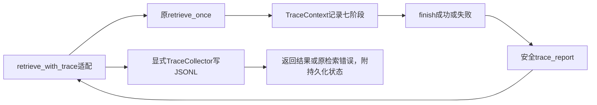

# Spec0015：M0第三切片——统一查询追踪与显式收集

日期：2026-10-11。状态：用户明确接受保留检索结果、观测写失败显式报告的策略并授权实施；本片已实现/接线并完成离线验收：63新增/660总测试。以下设计记录保留，实际实施见第7节。本片针对现有查询及最小收集，摄取模块随后消费同一机制；不提前建设Dashboard/Agent/HTTP/MCP。

## 1. 当前流与参考事实

当前retrieve_once在函数内record闭包记录request/resources/embedding/dense/sparse/fusion/packing七阶段，返回扁平trace列表，elapsed_ms为上次record到本次record的耗时。异常只记录固定stage/code并抛出，不向调用方交付完整已完成阶段、请求ID或总耗时；跨请求日志无法按ID关联。bootstrap已有安全资源错误日志。

参考URL：https://github.com/Jerry-ai-dev/MODULAR-RAG-MCP-SERVER；只读本地main固定commit f658c5a4011c8b826707a65a3b11ce9301b0626f，核验日期2026-10-11，未刷新远程/运行参考服务/复制源码。

真实参考链：query_knowledge_hub.execute创建TraceContext→初始化/search/rerank向同一对象record_stage→成功或异常调用TraceCollector.collect→to_dict写JSONL→Dashboard TraceService按trace_id读取。TraceContext含UUID/UTC开始结束/阶段/总耗时，monotonic计时；collect未finish时自动finish。Collector默认logs/traces.jsonl，mkdir，append，OSError记录exception后返回。

必要差异：参考MCP层会记录query前200字符及最终片段正文/source/title，我们不将正文或用户问题写日志；Collector写失败不能只日志后让调用方误认为已存储；M0仅串行本机离线，不复用参考默认路径或承诺多进程并发/取消。trace元数据为固定允许字段，不开放任意字典。

## 2. 目标、接口及兼容

采用参考的TraceContext/TraceCollector分工，新增独立查询收集适配，不在核心默认写文件。旧retrieve_once(request, resources, embed_query)签名保持；原trace列表及七阶段字段语义保持，算法/证据/错误身份不变。

计划新增结果trace_report字段，含安全的完整查询追踪；失败原RetrievalError实例附trace_report属性，原stage/code/字符串及类身份保持。两处新增公开字段属于本Spec明确的向后兼容扩展，需要确认，不提前改实现。日志添加trace_id供关联。未形成资源对象的非法请求也有失败追踪。

新增retrieve_with_trace(request, resources, embed_query, collector)，复用原retrieve_once并显式调用收集器。正常结果新增trace_persistence={status: written或failed, code: null或trace_write_failed}；失败原异常附同名属性后原样抛出。调用者显式构造TraceCollector(traces_path)，路径来自调用方配置参数；无默认写入路径，不自动修改YAML/.env或给Settings加未消费字段。原入口只返回追踪，不写磁盘。

TraceCollector.collect(trace_report)使用已校验完整报告字典，适配跨调用的序列化边界；参考收对象后to_dict，我们在核心返回处已完成to_dict。collect必须校验允许的报告字段及数值，不能接受任意敏感字典直接写入。收集成功返回，无自动retry/补写；失败抛安全TraceError('trace_write_failed')，由适配层明确报告。

## 3. 最小结构及数据流



TraceContext只先提供query类型、生成trace_id、record_stage、finish、to_dict和旧trace列表兼容转换；只有查询消费者，不提前声明摄取接线。report字段schema_version=1、trace_id、trace_type=query、started_at/finished_at UTC ISO、total_elapsed_ms、status=success/error、error=null或固定stage/code、stages。stages含stage、timestamp、elapsed_ms、data，不保存query/body/路径/模型原文/凭证/候选对象。

各stage允许data字段沿现有安全标量：request.status；resources.status/corpus_id/index_id（版本hash）；embedding.adapter_calls/source_kind/usage（prompt_tokens/total_tokens及可选completion_tokens，或null）；dense/sparse.compared_count/candidate_count；fusion.union_count/candidate_count；packing.selected_count/status/context_characters。未知字段、非有限数值、非法类型拒绝。旧validate_usage允许额外字段，新报告在调用点仅取其返回的已校验token字段，旧trace列表与旧结果中的usage完整保留兼容；不把额外字段复制入安全报告。record_stage返回本阶段elapsed_ms用于旧列表桥接，上下文另提供安全旧格式转换。错误stage限当前七阶段；错误code使用当前源码固定错误码允许清单，未知值写unknown_failure，不接受自由字符串。既有返回字典的query/候选证据不因此进入报告或日志。

计时用monotonic，UTC仅定位时间；保留旧stage elapsed_ms三位小数，total覆盖整个调用，包括失败前未完成阶段。失败终态独立error字段，不虚构未完成阶段为成功，也不在旧七阶段列表插入新的终态条目。finish只允许一次，完成后不能再记录；to_dict/兼容输出防御复制。

Collector路径显式校验后追加UTF-8 JSONL，自动创建缺失父目录，不清空/覆盖已有记录；每调用成功一行，用JSON严格有限值序列化。单进程串行用途，不声称多写者原子性/fsync/崩溃恢复；部分写入失败不保证一行完整，不自动删除/修文件，异常必须可见。

## 4. 文件范围

拟9个源码/测试文件，超过8项，仍同一M0功能，无新增服务：

1. core/trace_context.py：统一上下文、终态、严格报告校验/复制。
2. core/trace_collector.py：显式路径与安全JSONL追加。
3. tracing.py：retrieve_with_trace及可观察持久化失败策略。
4. retrieval.py：替换局部record实现接统一上下文，保留兼容列表；成功/失败交付报告，日志带trace_id。
5. core/errors.py：新增固定code TraceError，原类身份/构造保持。
6. core/__init__.py：新能力导出。
7. naiyue_rag/__init__.py：新增适配入口导出，旧导出保持。
8. tests/test_tracing.py：上下文/生命周期/严格字段/复制/计时/JSONL/IO失败安全。
9. tests/test_tracing_wiring.py：成功/非法请求/阶段失败/显式收集/旧四题回归。

每源码≤500行，现有测试/helpers/依赖不改；README/计划/交接/Spec索引/学习记录同步真实状态。真实运行配置、旧日志/缓存/源/向量不改；测试只tmp_path合成文件及缓存回调，无真实模型调用。

## 5. 异常与已确认策略

- 检索失败：finish(error)，原异常附安全报告，显式收集后仍抛原异常；写追踪失败不能遮盖检索错误。
- 检索成功但写追踪失败：保留检索成功结果，trace_persistence.status=failed/code=trace_write_failed，安全日志明确失败。调用方能观察，不能称整体追踪已持久化成功。
- Collector非法路径/无法初始化：在查询前抛安全TraceError，尚无查询追踪，不启动检索。
- 空召回/no_evidence_fits是完成查询，trace status=success，packing保留原结果状态；不是检索异常或业务正确通过。
- 不重试，不静默降级，不引入全局Collector、线程、本地服务、权限系统或OpenTelemetry。

用户已明确接受观测写入失败不抹掉检索结果、失败显式标出的策略，并授权按此方案实施。该取舍只涉及观测存储，不改变两路召回故障整次报错的已定策略。

## 6. 验收与回退边界（待执行）

先失败测试→最小实现；测试使用可控假时钟或事件，无sleep极紧窗口。核UUID唯一、单调耗时非负、终态完整/只能一次、报告副本隔离、字段/NaN/敏感哨兵拒绝、跨请求隔离、append保留已有记录、JSONL重读完整、异常日志安全。真实七阶段/各阶段异常可追踪，无后续Embedding/检索副作用；旧四题候选/预算/证据精确保持。日志与report无敏感正文，usage未知为null，不编费用。

显式适配调用完成→重读tmp_path JSONL，trace_id/状态/各阶段与返回一致；模拟写失败时结果仍可见且持久化失败明确；检索与写入双失败时原RetrievalError类别/消息保持。原retrieve_once不创建日志文件；旧全部测试保持，核心新模块不导入experiments。

计划命令，未执行，禁止预填通过数：

```sh
.venv/bin/python -m pytest -q tests/test_tracing.py tests/test_tracing_wiring.py
.venv/bin/python -m pytest -q tests
.venv/bin/python -m compileall -q naiyue_rag experiments tests
.venv/bin/python -m pip check
git diff --check
```

L1检查9文件；L2真实计时/校验/异常/写入；L3原查询各阶段→报告→显式收集→重读JSONL及错误分支。构建不适用，compileall仅语法检查。该片通过只能记现有查询最小追踪，摄取消费者/管理/并发与生产验收仍待。

旧入口签名/算法/证据保留，不迁移索引/文档，默认无磁盘副作用；调用方可继续旧入口。回退不自动删除日志或代码，破坏性回滚按用户授权另行执行。已写JSONL为独立观测数据，日志轮换/清理/恢复到真实运维阶段讨论。

设计时下一步为确认后实施，现已按明确授权完成；当前下一步为追踪失败策略小课，然后准备M1 Markdown加载Spec。

## 7. 实际实施与验收（2026-10-11）

在9源码/测试文件范围内完成TraceContext/TraceCollector/retrieve_with_trace、原retrieve_once接线、安全错误和导出。无新依赖、真实运行配置/旧日志/索引变更或模型调用，无提交/push或其他仓库修改。参考为概念/接口借鉴，未复制第三方源码或运行参考服务。

TDD实际：首次2收集错误（缺TraceError/新入口）→最小实现56新增通过。状态仅比较值的类型漏洞：新增回归DID NOT RAISE→显式str检查→57通过。新增真实IO边界open/write/close故障测试→60新增/657全量通过。再核实际load_corpus固定错误码，unit_identity/body_span/context_span误归unknown：3参数回归红灯→修清单→最终63新增/660全量通过。未修改旧测试/helpers、放宽断言或skip。

实际最终命令：

```sh
.venv/bin/python -m pytest -q tests/test_tracing.py tests/test_tracing_wiring.py
# 63 passed in 5.26s
.venv/bin/python -m pytest -q tests
# 660 passed in 57.99s
.venv/bin/python -m compileall -q naiyue_rag experiments tests
# exit 0，无输出，语法检查；打包构建不适用
.venv/bin/python -m pip check
# No broken requirements found.
git diff --check
# exit 0，无输出
```

L1：9文件存在，trace_context187行/collector38/tracing30/retrieval126，测试177/204，均≤500。L2：UUID/UTC/单调时间、严格安全字段/计数/错误目录、一次终态与防御复制、真实UTF-8 JSONL append和短写/关闭错误检查，非占位。上下文采用普通私有状态对象，提供参考的核心方法，以固定字段校验替代自由metadata；只消费query，不声明ingestion已接线。record_stage返回耗时用于旧列表桥接，report安全归一化usage不改旧usage扩展。

L3：真实原查询七阶段调用TraceContext→finish→结果或原错误的trace_report→显式retrieve_with_trace→Collector→JSONL重读，与返回报告一致。默认retrieve_once不新增日志文件。原四题缓存候选/证据/预算各字段精确保持，显式适配写四份报告且ID不同。失败记录完成阶段前缀与终态，非法请求/资源在Embedding前拒绝，空/no_evidence_fits标查询成功而非业务质量通过。模拟提供者/原缓存与真实服务区分。

IO失败验收：真实Collector的open/write/close边界注入OSError，结果selected保持、trace_persistence=failed/trace_write_failed、一次写尝试；检索+收集双失败仍为同一个原RetrievalError对象与原消息。未知自由错误码在报告及日志中变unknown_failure；既有usage额外敏感哨兵仍在旧结果供兼容，但不在安全report/JSONL/日志。Collector初始化/校验/写失败可见，未自动重试或删除。

保护证据data/research/spec0015-evidence：146既有代码/测试/Mock/锁/历史基线文件hash保持（含58基线资产）；4允许改动旧文件另存前状态；135分发版本一致，新core源码实验导入0。source-checks记录9文件hash/行数，原staged/untracked工作保留。

范围限制：当前本机串行查询，JSONL写成功表示write及close返回，不承诺fsync/多写者原子性；失败可能已有部分或完整字节落盘，不自动修复/重试。暂无摄取追踪消费者、Dashboard、轮换、异步取消/并发、真实大库或生产验收。原检索/资源仍依赖experiments与冻结Mock/向量缓存，新追踪模块自身不导入实验；未把报告存在当业务质量通过。

M0三基础切片对当前A2消费者已验收，后续M1–M5继续接公共类型/配置/追踪，不宣称全项目或完整生产模块成熟。新追踪代码尚未逐行讲解/本人复写，不预填Lesson8或个人掌握。

唯一下一步：讲retrieve_with_trace成功/写失败/双失败的一条控制流，然后准备M1 Markdown加载Spec。
