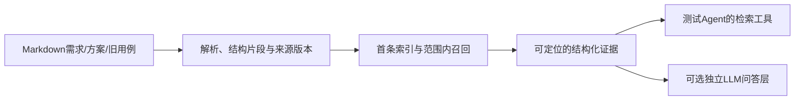

# Markdown 测试知识库：RAG、知识图谱与 Agent 工具的定向调研

日期：2026-10-09。模式：rndflow `only research`。用户已确认查询计划并要求补搜“知识库、RAG、知识图谱”等关键词。报告交付后待用户审阅，不自动作为已批准方向或阶段 Spec。

调研锚点：把用户自己的 Markdown 需求、方案和既有用例变成可追溯知识库，供测试 Agent 查询证据、回答问题和辅助用例设计；以后可加 MCP，本项目也可有独立问答层。参考项目主要提供技术参照。

## 结论与推荐

本轮看到的路线分为：完整知识库平台；Python 可组合摄取/索引/检索组件；图谱结合检索；托管检索 API。现成方案已经覆盖大量基础机制，可以按需组合。项目自己的文档角色、有效版本、原文定位、证据契约和测试任务评测仍要明确设计。

建议以小型独立 Python 证据知识库为首期方向：保留原 Markdown，按结构形成可定位片段，维护项目/模块/文档角色/版本，建立单路检索基线并返回结构化证据。LlamaIndex 等可作为组件对照或后续适配候选。基线采用关键词还是向量，需结合少量真实样本做最小实验；尚未确认模型、分词、向量库或框架。MCP 包装稳定的查询契约，独立问答层消费同一证据。此为调研建议，不是已批准实现方案。

知识图谱值得比较，但只有出现可标注的跨文档关系问题、基础召回失败并证实图关系有帮助时，才引入自动建图。需求/方案/用例已有显式编号与链接时，可以先保存这些可靠关联，不能把模型抽取关系当成真实覆盖证明。GraphRAG 并不是所有知识库都必须经过的阶段。

## 知识库、RAG 与图谱各是什么

知识库是材料和索引的工程组织：有哪些文档、属于哪个项目、哪个版本有效、原文在哪里、怎样更新，以及查询时返回哪些证据。向量数据库只承担其中一种索引职责。

RAG 在这里分成摄取和查询：摄取把源文档变成片段和可搜索索引；查询先取出证据，再由 Agent 或可选问答层组织回答。关键词召回适合检查需求编号、接口名和特定术语；向量召回用于语义接近的表达；混合、融合和重排是在固定集上可逐项比较的改进，而非一次全装的必要前提。上述适用性是待材料检验的设计假设，未测中文或业务质量。

图谱增加实体和关系的索引。例如“REQ-17 由 DESIGN-8 实现，CASE-42 验证它”若在材料里明确存在，就可形成可追溯关系。Microsoft GraphRAG 还生成社区摘要用于汇总型问答；LightRAG 的实体/关系向量检索和片段召回是另一种算法。两者名为 local/global 的模式含义不同。

## 指定方向与实际搜索

GitHub 20 条、Web 13 条查询全部执行。GitHub 11 条有结果、9 条零结果、0 条调用错误；Web 13 条有结果、0 条错误。宽查询包括中文“知识库 RAG”、英文 knowledge graph RAG、rag/knowledge-base 与 graphrag topic；先执行指定项目方向和补充方向。过窄的多词 GitHub 查询没有结果，补查框架/完整平台时保留了新增查询及原因。

发现结果规范化后保留 1,409 条：GitHub 1,032、Web 377；七个进入深验（GitHub 五个、Web 两个），1,402 条仅保留发现索引，含可能误命中，不能作为成熟性结论。raw Web response 与规范化结果逐条比对，全部搜索条目均保留；GitHub 同仓库多查询命中合并 discoveries。没有按 star 选择方案，也没有声称这些样本代表采用率。

`source=web`、`provider=openai_native`、`transport=host_native`。搜索摘要只作弱证据；报告机制来自固定 commit 的源码或供应商一手文档。raw response 可导出已保存；网页 HTML 快照另保存在 preselection 中。没有搜索 X，没有索要新 key。

## 深验候选与真实机制

| 候选 | 问题和调用链 | 可以借鉴什么 | 接入与主要边界 | 证据 |
|---|---|---|---|---|
| 指定 Modular RAG MCP Server | 默认 PDF→切分增强→Embedding→Chroma/BM25；查询两路→RRF→可选重排→MCP引用 | 摄取/查询/适配分层、阶段trace、接线核对 | Python>=3.10；多种依赖；默认不是Markdown；Chunk类型有offset但该切分入口未填；MCP搜索异常可变空结果 | [深验](deep/modular-rag.md)，[固定源码](https://github.com/jerry-ai-dev/MODULAR-RAG-MCP-SERVER/tree/f658c5a4011c8b826707a65a3b11ce9301b0626f) |
| LlamaIndex | Document→明确选择的parser/transform→embedding/vector store；retriever返回NodeWithScore；query_engine另接LLM | 节点与文档分离、metadata预过滤、检索/生成分离、cache/docstore职责 | Python>=3.10,<4，MIT；默认parser并非Markdown；专门MarkdownReader会重组原文；稳定ID/原文件行号/业务版本需自有契约 | [深验](deep/llama-index.md)，[Markdown parser源码](https://github.com/run-llama/llama_index/blob/6dd2f3cdd9ce7ff927ea8d46ccee08875bb00f95/llama-index-core/llama_index/core/node_parser/file/markdown.py) |
| RAGFlow | 上传blob/元数据→解析/切分→模型编码及索引；SDK检索与chat分开；MCP复用检索服务 | 完整产品的文档管理、过滤、纯检索接口和引用组织 | 当前main为1.0.0-rc1混合Go/Python架构；README明确Go后端暂不支持macOS，Python项目要求3.13；容器与多服务前提重；所读retrieval入口的use_kg会warning后跳过，chat入口另有图路径 | [深验](deep/ragflow.md)，[固定源码](https://github.com/infiniflow/ragflow/tree/1c970958db31d8a4872ee4d2595913897ae7676b) |
| Microsoft GraphRAG | 切分→LLM实体/关系→描述总结→社区→社区报告→向量；Local建图上下文；Global社区报告map/reduce后答案 | 区分局部关联和语料汇总问题、源片段追踪、预算 | MIT，Python>=3.11,<3.14；普通文本读取不自动解析Markdown结构；标准建图/Global增加多处LLM调用；同title正文更新未在所追增量链被识别为新文档 | [深验](deep/graphrag.md)，[索引工厂](https://github.com/microsoft/graphrag/blob/5faaaf4f5685fa2056fa8c3bf9342cb089f2942f/packages/graphrag/graphrag/index/workflows/factory.py) |
| LightRAG | 片段→LLM实体/关系→图与三类向量；local找实体、global找关系、mix另加片段向量；query_data可只返上下文 | 独立query_data、图来源贡献、naive与图路径对照 | MIT，Python>=3.10；query_data默认仍可能调用关键词LLM；同名更新/图删除重建比普通片段索引复杂；出口未自动满足完整版本行号契约 | [深验](deep/lightrag.md)，[query_data源码](https://github.com/HKUDS/LightRAG/blob/453dce83d6d0354a06e46c8d4029a0895c4e054b/lightrag/lightrag.py#L4876) |
| Gemini File Search | 官方SDK创建store→upload/import→索引operation→模型file_search工具→可选引用 | 快速托管问答和引用接口作对照 | 闭源服务；需供应商账户/费用/材料外发范围；所读接口未证明独立完整证据契约和内部召回控制 | [深验](deep/hosted-services.md)，[官方文档](https://ai.google.dev/gemini-api/docs/file-search) |
| Azure AI Search knowledge base retrieve | 资源/知识源配置→鉴权→retrieve提取证据或版本支持的答案合成→activity/references；可API/MCP消费 | 证据、活动与答案模式的接口分离、来源预算 | 托管资源成本；SDK/API能力随版本变化，部分为preview；本轮仅文档，未上线或调用 | [深验](deep/hosted-services.md)，[官方文档](https://learn.microsoft.com/en-us/azure/search/agentic-retrieval-how-to-retrieve) |

这些候选均为 `partial_borrow`；不是生产成熟度认证。LlamaIndex组件可进入本项目对照实验，完整平台/托管产品也有可获得的使用入口，但没有在本机或我们的资料上验证。框架不是只凭API数量决定，选择应考虑需理解的状态、依赖和维护面。

## 参考项目怎样接大模型

指定项目将 Embedding 和聊天LLM分开配置。EmbeddingFactory在摄取和DenseRetriever查询中向量化；LLMFactory供片段refine、metadata enrichment和可选LLM rerank使用。MCP的ResponseBuilder在该路径中格式化证据，没有生成问题答案；评测answer_generator默认拼接正文。

LlamaIndex提供更直接的两种入口：retriever输出NodeWithScore，query_engine再接synthesizer与LLM。LightRAG有query_data，但图检索的关键词抽取仍可能用LLM。这说明“纯证据结果”“跳过答案生成”“整个过程无聊天模型调用”是三个不同事实，接入与成本要逐段验证。详见各深验笔记与固定代码。

我们的Embedding接口、聊天接口、Rerank接口都未确认。已有Agent网关只证明了它被验证过的调用能力，不能自动当作这里三类接口均可用。本轮没有读取或复制网关凭证，没有真实模型请求，费用/token/检索质量均未知。

## 生命周期与业务证据的共性缺口

### 用户补充后的跨文档路线比较（2026-10-09）

用户指出只比较LangChain切分器与LlamaIndex节点不足以作整体选型。已知真实任务需要历史需求、模块背景、计算规则、其他需求边界与旧用例共同组成证据集合。因此摄取组件比较保留，但整体候选必须覆盖跨文档召回、已有关系补充、图谱及证据组装。用户对先前分析的认可不记为具体技术栈批准。

跨文档问题分为：多份文档各自可召回；需沿已写出的引用/用例名称配对补充；需识别没有显式链接的内容/实体关系；需比较不同时间的规则。检索机制可组合，不按框架名或文档数量直接裁定是否建图。最后一类的现行有效性判断仍需相关原文和上层核对，图边或最新日期不自动给出业务事实。

| 候选/角色 | 所读真实机制 | 针对本任务的设计假设与待验边界 |
|---|---|---|
| Modular：主要工程参考及基础召回路线 | Dense/BM25→RRF→可选rerank→MCP证据 | 多文档可共存于索引，但所追通用召回链未证明按L0/L1/L2及用例关系补齐；可作为全库片段召回对照，已有关系扩展须单独设计验证 |
| LangChain/LlamaIndex：组合组件 | 文本/节点、模型与索引适配、检索输出 | 属于实现工具，选择其切分器不等于已选择跨文档策略；父章节背景与关联文档补充是不同关系，需要分别核验 |
| LightRAG：图与片段向量的正式对照 | 实体/关系抽取；mix将图上下文与片段向量组合；query_data返回结构化上下文 | 可能补充无显式链接的关联证据，须检查关系依据、原文定位、版本及图更新；纯上下文仍可能有关键词LLM，费用未知 |
| Microsoft GraphRAG：实体关系及全库汇总路线 | Local按实体组合关系与原文片段；Global基于社区报告做map/reduce | Local可比较关联证据补齐；Global评价跨库总结类任务，不把社区报告当原始规则；公开查询通常含答案生成，纯证据接入需适配下层context builder |
| RAGFlow：完整平台对照 | 多文档检索、过滤、混合召回/重排；摄取与管理服务 | 可比较完整产品适配成本，源码快照的retrieve入口use_kg会warning并跳过，chat另有图路径，不能从KG参数推断证据接口接线；部署与自有契约需验证 |

建议保留的候选路线：A为基础片段检索，再单独对照已有引用/名称关系补充；B为LightRAG图+片段检索。Microsoft GraphRAG Local保留为另一图机制候选，Global在全库总结问题出现时单独评价；RAGFlow保留为完整产品路线，不把前述组件选择直接当整体架构选择。此为选型建议，未批准、未安装、未运行，不表示图路线已被排除或效果更好。

同一任务评价的是相关原文片段集合：按历史需求、旧用例、模块背景分别检查召回，再检查关键关系所需两端证据是否到齐、噪声与版本冲突。关系覆盖的标注及计算方法在实验前定义，人工确认与模型候选分开。A的基础检索与关系扩展分开实验；B的图贡献比较须尽量固定输入片段与模型，不能固定时显式报告差异。不同系统的端到端结果与单变量算法实验分别命名，避免把解析/切分差异归为图谱收益。成本、延迟和服务结果目前均未知。

上述事实来自[Modular](deep/modular-rag.md)、[LlamaIndex](deep/llama-index.md)、[LightRAG](deep/lightrag.md)、[GraphRAG](deep/graphrag.md)、[RAGFlow](deep/ragflow.md)的固定源码链。官方页面复核：[GraphRAG Local](https://microsoft.github.io/graphrag/query/local_search/)、[Global](https://microsoft.github.io/graphrag/query/global_search/)；补充原响应保存于[页面读取记录](raw/web/cross-document-page-reads-2026-10-09.json)。仍限定静态证据，没有我们的业务质量证明。Haystack/Dify等发现候选尚未深验，不凭名称给采用结论。

本轮找到一条有仓库回归记录的历史解析故障：RAGFlow的Markdown解析曾把货币美元符号之间的正文当MathJax丢弃，当前实现禁用该选项并有内容保留断言。我们只读了注释/修复/测试，未复现或运行它。[回归源码](https://github.com/infiniflow/ragflow/blob/1c970958db31d8a4872ee4d2595913897ae7676b/internal/parser/parser/markdown_parser_test.go#L282)。这支持首期验证需求正文、金额、表格与编号保留，不能用解析成功返回代替内容检查。

其余以下条目是源码/文档边界与待实验风险，不是已发生故障。本轮没有足够证据判任何路线不可行。

| 问题 | 两个以上候选的实际机制 | 对本项目的意义 |
|---|---|---|
| 原文位置不等于有来源字段 | Modular切分不填offset；LlamaIndex位置相对所用Document且Reader可能重组；GraphRAG默认text_units无Markdown行范围；LightRAG部分provenance未全部透传query_data | 首期保留原文和位置映射，序列化/引用定位必须有测试；不能只看字段名 |
| 文档身份和更新需明确 | LlamaIndex稳定doc ID/hash决定upsert；GraphRAG所追delta按title；LightRAG同basename重复不是原子版本覆盖 | 固定document_id与content/index版本含义，验证重复、修改、失败和旧版本可见性 |
| 原文与模型派生内容需区分 | Modular的refine改变正文；GraphRAG实体描述/社区报告与LightRAG实体关系来自模型 | 保存原证据并标记派生内容，模型关系不能作需求事实或用例覆盖证明 |
| 通用检索不自动提供测试业务权威性 | LlamaIndex与RAGFlow所追链允许注入metadata和过滤，未发现自动裁决需求/方案/旧用例权威性 | 明确文档角色和有效状态；旧用例与新需求冲突是固定评测场景 |

证据：[Modular笔记](deep/modular-rag.md)、[LlamaIndex笔记](deep/llama-index.md)、[GraphRAG笔记](deep/graphrag.md)、[LightRAG笔记](deep/lightrag.md)、[RAGFlow笔记](deep/ragflow.md)。以上限定本轮所追链路，不声称行业都未解决。

## 建议的最小验证实验与学习顺序

1. 先只读少量用户确认可用的Markdown，包含需求、方案、旧用例；检查标题、表格、编号、代码块、版本、语言和原文链接。明确哪些可本地索引、哪些可外发到Embedding/LLM。
2. 写出真实任务：精确术语/编号、同义表达、跨需求与用例的问题、过期规则冲突、没有答案的问题。人工标注原始相关片段与文档角色；合成标签不混成人工业务真值。
3. 明确source→Document→Chunk→Evidence契约；先验证结构和位置。原正文、来源路径、document_id/chunk_id、版本、位置、方法/rank/score是草案，按样本定稿。
4. 建立一条基础召回路径及可重复评测。关键词与向量用同样问题单独比较，语言决定分词，模型决定编码预算；冻结切分与模型/索引版本。基线之外每次只改变一个变量，再讨论融合/重排。
5. 检索按片段级Recall@k（命中相关片段数/全部相关片段数）和逐题排序/失败分析，无答案样本单独评分。框架默认hit_rate不是Recall；LLM回答另评引用存在及主张支持。
6. 让测试Agent消费结构化证据；需要跨进程时包装MCP。若需要独立问答，再接模型适配层，不重复建设Agent会话控制。
7. 只有固定关系问题显示缺口，才用同一语料比较基础召回与图路线，并额外测关系事实准确率、图更新、模型调用量、延迟和成本。

课程先讲一份Markdown怎样变成可定位证据，再读真实摄取和查询代码；Embedding、BM25、融合、重排与图谱分别用小实验推进。没有用户复述、练习、调试证据，不把本轮调研记为独立掌握。

## 版本、许可证与验证边界

| 固定仓库 | main commit | 已核对授权/运行前提 |
|---|---|---|
| Modular | f658c5a4011c8b826707a65a3b11ce9301b0626f | pyproject声明MIT，树中未发现LICENSE；复制代码前补核授权 |
| LlamaIndex | 6dd2f3cdd9ce7ff927ea8d46ccee08875bb00f95 | MIT；core0.14.25/file-reader0.7.0 |
| RAGFlow | 1c970958db31d8a4872ee4d2595913897ae7676b | Apache2.0；具体环境依深验，不复用Agent环境 |
| GraphRAG | 5faaaf4f5685fa2056fa8c3bf9342cb089f2942f | MIT；当前README写maintenance mode，属于项目自述，非路线不可行证据 |
| LightRAG | 453dce83d6d0354a06e46c8d4029a0895c4e054b | MIT；Python>=3.10 |

source checkout为只读调研用浅/稀疏克隆，未复制源码进入naiyue-rag产品，也未执行第三方setup、Skill、安装、Docker或服务。静态L1文件存在/L2所读入口有实质实现/L3源码调用接线可追，均不代替本机运行或真实业务验证。

工作区检查：Skill validate_workspace检查查询覆盖、方向优先级、卡片和深验预算；JSON/证据路径/源码commit与文档链接核对另见validation.json。RAG业务构建/测试当前不适用，因为本项目只有文档和调研资料，没有功能代码。此报告不宣称生产就绪、个人实现经历、收益或线上规模。

## 附录：可复核证据

- [查询与授权记录](queries.json)，[GitHub执行记录](raw/github/query-runs.json)。
- [候选全集](candidates.json)，[限额选择与未选理由](selection.json)，[不同问题域淘汰表](rejected.json)（本轮没有以深验事实淘汰的条目；未读候选保留）。
- cards/ 每候选卡；deep/ 七候选的六篇机制笔记；raw/ 包含来源时间、Web后端、原响应与预选使用文档；[固定clone快照](raw/clone-snapshots.json)。
- 未深验的Dify、Haystack、Bedrock、NVIDIA及其他候选只作发现记录，未给成熟性或采用结论；不能根据附录名单直接选型。

唯一下一步：用户审阅本轮推荐与证据边界；接受后，以少量实际Markdown和真实问题定义首个切片的Spec与学习例子。
